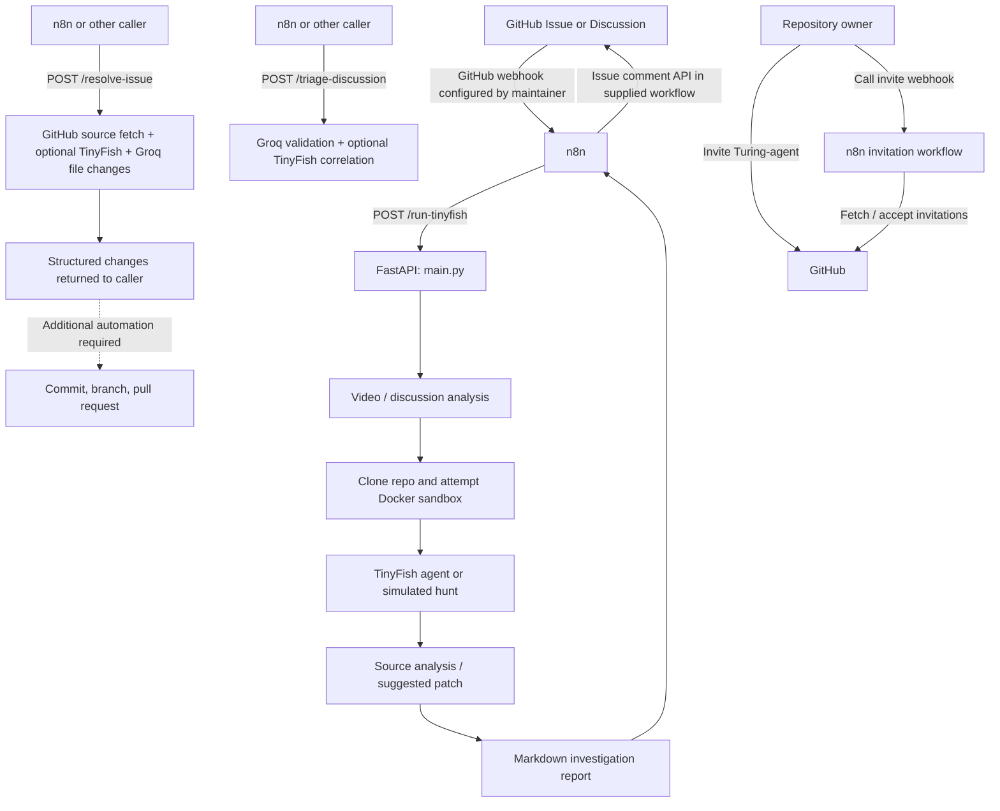

# Turing-Agent 🐟

**GitHub issue triage, QA investigation, and AI-assisted code-fix backend**

Turing-Agent is a Python/FastAPI service intended to work with GitHub and [n8n](https://n8n.io/) to process bug reports, propose reproduction steps, correlate related issues, and suggest code changes. The repository includes a TinyFish-powered investigation path, Groq-powered discussion triage and fix generation, and an invitation-acceptance workflow for the `Turing-agent` GitHub account.

> **Implementation status:** This repository includes both live API integrations and simulated/fallback behavior. A generated investigation report or patch is **not automatically proof that a bug was reproduced, a fix was tested, or a pull request was opened**. See [Current limitations](#current-limitations) before using this system for production automation.

<br clear="right" />

## Contents

- [Architecture](#architecture)
- [Features and modules](#features-and-modules)
- [Repository layout](#repository-layout)
- [Prerequisites](#prerequisites)
- [Local setup](#local-setup)
- [Configuration](#configuration)
- [API reference](#api-reference)
- [n8n integration](#n8n-integration)
- [Collaborator invitation workflow](#collaborator-invitation-workflow)
- [Current limitations](#current-limitations)
- [Development and troubleshooting](#development-and-troubleshooting)
- [License](#license)

## Architecture



The bundled `turing-agent-workflow.json` covers the **investigation → issue comment** route. The bundled invitation workflow handles **collaborator invitations**. The supplied n8n exports do **not** include a complete workflow that invokes `/triage-discussion` or turns `/resolve-issue` output into a GitHub commit and pull request.

## Features and modules

| Component | Responsibility | File |
| --- | --- | --- |
| API orchestrator | FastAPI routes, investigation pipeline, triage, and fix-generation endpoints | `main.py` |
| Video and text intake | Download optional video; sample up to 12 frames at roughly 1 fps; use OpenAI vision or keyword-based fallback to create a reproduction plan | `vision_module.py` |
| Sandbox provisioning | Clone the configured RepoOwl repository; try a `node:20-alpine` Docker container; fall back to a temporary local directory | `docker_provisioner.py` |
| Reproduction agent | Attempt a live TinyFish web-agent run when configured, otherwise produce a simulated investigation | `agent_runner.py` |
| Root-cause suggestions | Inspect repository source and use OpenAI or predefined heuristics to propose an explanation and patch | `analyzer.py` |
| Discussion correlation | Generate Groq-based validation comments and optionally fetch prior GitHub issues via TinyFish | `tinyfish_correlator.py` |
| n8n investigation | Accept webhook payload, call backend, and post to GitHub's issue-comment endpoint | `turing-agent-workflow.json` |
| n8n onboarding | Retrieve and accept pending repository collaborator invitations | `accept-turing-invite-workflow.json` |
| Invite helpers | GitHub CLI and webhook helpers for Bash/Zsh and PowerShell | `scripts/invite_turing.sh`, `scripts/invite_turing.ps1` |

### Investigation pipeline (`POST /run-tinyfish`)

1. **Plan:** Combine the discussion title/body with optional video frames. `OPENAI_API_KEY` and `VISION_MODEL_PROVIDER=openai` enable the OpenAI vision path; otherwise the code uses a deterministic, keyword-driven fallback.
2. **Provision:** Clone `https://github.com/YASHK-arch/RepoOwl-extension.git` into a temporary directory, then attempt to launch a Docker container. If Docker fails, the code retains a temporary **workspace**, not a running local web server.
3. **Hunt:** Call TinyFish's remote agent for a publicly reachable URL when `TINYFISH_API_KEY` is available and `TINYFISH_MOCK=false`. Otherwise use the simulated path. Supplying `live_url` replaces the sandbox's target URL, but the clone/provisioning step still runs.
4. **Analyze:** Scan a limited number of repository files and request an OpenAI diagnosis if configured, or use heuristic suggestions.
5. **Report:** Return Markdown describing the plan, sandbox details, investigation result, and a suggested patch. The temporary sandbox is torn down after the request.

### Issue resolution (`POST /resolve-issue`)

For an approved GitHub issue, the service fetches the repository's recursive tree using GitHub's API, selects up to **15** small eligible source files, optionally inspects a live deployment with TinyFish, and asks Groq to return complete proposed file contents, a commit message, and a summary. The endpoint **does not modify GitHub files, create a branch, run tests, or open a pull request**.

### Discussion triage (`POST /triage-discussion`)

Groq drafts a maintainer-style validation comment. If a TinyFish key is configured, the backend also attempts to inspect up to **three** previous repository issues and synthesize a correlation report. Without scraped issues, a fixed fallback correlation message is returned. These are **generated assessments**, not independently verified resolutions.

## Repository layout

```text
.
├── .agents/
│   └── mcp_config.json                 # n8n MCP endpoint configuration
├── scripts/
│   ├── invite_turing.sh                # Bash / Zsh invitation helper
│   └── invite_turing.ps1               # PowerShell invitation helper
├── main.py                             # FastAPI application and API routes
├── vision_module.py                    # Video analysis and reproduction plan
├── docker_provisioner.py               # Repository clone / sandbox lifecycle
├── agent_runner.py                     # Live TinyFish or simulated execution
├── analyzer.py                         # Source inspection and patch proposals
├── tinyfish_correlator.py              # Groq validation and issue correlation
├── turing-agent-workflow.json          # n8n issue investigation workflow
├── accept-turing-invite-workflow.json   # n8n invitation workflow
├── architecture.png                    # Conceptual architecture illustration
├── payload_approved.json               # Example GitHub API error response (UTF-16)
├── requirements.txt                    # Python runtime dependencies
├── LICENSE
└── README.md
```

`architecture.png` depicts a broader **conceptual** workflow, including steps that are not fully present in the supplied code. This README's architecture diagram distinguishes implemented endpoints from downstream automation still required.

## Prerequisites

- Python **3.10+** and `pip` (a virtual environment is recommended).
- Git for cloning repositories.
- Docker Desktop / an accessible Docker daemon **optional**, for attempting a containerized investigation. The fallback does not start the target application.
- API credentials as needed for specific integrations (see below).
- For n8n: an n8n instance that can reach the FastAPI backend, and a GitHub token with permissions appropriate to the workflow.
- For invitation helpers: [GitHub CLI (`gh`)](https://cli.github.com/) authenticated as the repository owner or another account permitted to invite collaborators.

## Local setup

1. Clone the **actual team repository** (replace the placeholder with its URL; do not assume the backend's hard-coded RepoOwl target is the Turing-Agent repository):

   ```bash
   git clone <YOUR_TURING_AGENT_REPOSITORY_URL>
   cd <YOUR_CLONED_REPOSITORY_DIRECTORY>
   ```

2. Create a virtual environment and install dependencies:

   ```bash
   python3 -m venv .venv
   source .venv/bin/activate  # macOS / Linux
   python -m pip install -r requirements.txt
   ```

   On Windows PowerShell, activate with `.venv\Scripts\Activate.ps1`.

3. Configure a local `.env` file as needed. The repository's `.gitignore` excludes `.env` and `.env.*` except `.env.example`. **Never commit real tokens.**

   ```dotenv
   # Vision / root-cause analysis (optional for fallback behavior)
   OPENAI_API_KEY=
   VISION_MODEL_PROVIDER=local

   # TinyFish remote agent and issue scraping (optional)
   TINYFISH_API_KEY=
   TINYFISH_MOCK=true

   # Groq is required for /triage-discussion and /resolve-issue
   GROQ_API_KEY=
   # GROQ_MODEL=your-supported-model-id

   # GitHub REST requests (required for /resolve-issue and invitation acceptance)
   GITHUB_TOKEN=
   ```

4. **Check the known import blocker described below before starting the app.** In the supplied snapshot, `main.py` references `List` without importing it, so `uvicorn` cannot start until that code issue is fixed on your working branch or upstream.

5. Once the import issue is resolved, launch the backend:

   ```bash
   uvicorn main:app --reload --host 127.0.0.1 --port 8000
   ```

6. Confirm the health endpoint:

   ```bash
   curl http://127.0.0.1:8000/
   ```

   Interactive FastAPI docs are available at `http://127.0.0.1:8000/docs` when the server is running.

> `PORT` is **not read directly** by `main.py` in this snapshot. Set the server port with the `uvicorn --port` argument (or your process manager), not by relying on `PORT` alone.

## Configuration

| Variable | Used by | Requirement / default |
| --- | --- | --- |
| `OPENAI_API_KEY` | Vision and `analyzer.py` | Optional. Without it, uses deterministic alternatives. |
| `VISION_MODEL_PROVIDER` | `vision_module.py` | Defaults to `openai`; uses OpenAI only if its API key is set, otherwise uses keyword-based fallback. `local` is **not** an integrated Ollama/vLLM backend. |
| `TINYFISH_API_KEY` | Agent, triage, optional live issue inspection | Optional for simulated investigation; needed for live TinyFish requests. |
| `TINYFISH_MOCK` | `agent_runner.py` | Defaults to `true`. Set `false` **and** provide a TinyFish key to attempt remote execution on a publicly reachable URL. |
| `GROQ_API_KEY` | Triage and issue resolution | Required by `/triage-discussion` and `/resolve-issue`. |
| `GROQ_MODEL` | Groq calls | Optional first-choice model; code has additional model names as fallbacks. |
| `GITHUB_TOKEN` | GitHub file fetching and invite acceptance | Required for authenticated GitHub operations. Use only the permissions needed for each workflow. |
| `TURING_AGENT_URL` | n8n investigation workflow | Base URL of the backend, defaults in workflow JSON to `http://127.0.0.1:8000`. Use an address **reachable from n8n**. |
| `TURING_N8N_INVITE_WEBHOOK` | Invitation shell scripts | The **actual** n8n production webhook URL, not the placeholder in the scripts. |

The first seven variables are used by Python. The final two are used by n8n or the invitation scripts, not read by the FastAPI app.

## API reference

FastAPI defines these five route paths (six HTTP method/path combinations):

| Method | Path | Purpose |
| --- | --- | --- |
| `GET` | `/` | Health/status response; reports application version `2.0.0`. |
| `POST` | `/run-tinyfish` | Return an investigation report for an issue/discussion. |
| `POST` | `/triage-discussion` | Return generated validation and issue-correlation comments. |
| `POST` | `/resolve-issue` | Return Groq-generated proposed file changes. |
| `GET`, `POST` | `/accept-turing-invite` | Accept pending invitations for the GitHub account represented by `GITHUB_TOKEN`. |

### `POST /run-tinyfish`

Request fields include optional `discussion_title`/`discussion_body` (or aliases `title`/`body`), `video_url`, `media_urls`, `live_url`, `discussion_url`, `discussion_number`, `repository`, and `author`.

```bash
curl -X POST http://127.0.0.1:8000/run-tinyfish \
  -H 'Content-Type: application/json' \
  -d '{
    "discussion_title": "Bug: settings action fails",
    "discussion_body": "Describe the affected page, steps, and expected behavior.",
    "video_url": null,
    "live_url": null
  }'
```

A normal response has this structure:

```json
{
  "status": "success",
  "report": "## TinyFish Investigation Report..."
}
```

**Important:** This endpoint also catches operational exceptions and can return HTTP 200 with `status: "success"` **and an error diagnostic inside `report`**. Consumers must inspect the report; HTTP 200 alone does not mean the investigation succeeded. Mock-mode reports are simulated.

### `POST /triage-discussion`

Requires `GROQ_API_KEY`. All of `discussion_title` and `discussion_body` are required; other listed fields are optional.

```bash
curl -X POST http://127.0.0.1:8000/triage-discussion \
  -H 'Content-Type: application/json' \
  -d '{
    "discussion_title": "Bug: login redirect fails",
    "discussion_body": "After logging in, the application remains on the sign-in screen.",
    "discussion_number": 17,
    "author": "example-user",
    "repository": "OWNER/REPO"
  }'
```

Expected response keys: `status`, `validation_comment`, `tinyfish_correlation_comment`, and `scraped_issues_count`. Groq errors return HTTP 500.

### `POST /resolve-issue`

Requires `GROQ_API_KEY` and GitHub repository access through `GITHUB_TOKEN`. The caller must supply an existing Git **tree SHA** for the intended base (not an arbitrary branch name). The endpoint proposes changes; **it does not apply them**.

```bash
curl -X POST http://127.0.0.1:8000/resolve-issue \
  -H 'Content-Type: application/json' \
  -d '{
    "issue_title": "Fix incorrect login redirect",
    "issue_body": "Steps to reproduce and expected behavior...",
    "issue_number": 17,
    "repo_full_name": "OWNER/REPO",
    "base_tree_sha": "REPLACE_WITH_REAL_GIT_TREE_SHA",
    "discussion_url": null,
    "live_url": null
  }'
```

Example response **shape**:

```json
{
  "status": "success",
  "commit_message": "fix: correct login redirect",
  "summary": "Proposed changes to login routing.",
  "changes": [
    {"path": "src/example.js", "content": "/* proposed full file contents */"}
  ],
  "files_analyzed": 10,
  "tinyfish_summary": null,
  "tinyfish_screenshots": [],
  "live_url": null
}
```

The example values above are illustrative, **not output from a tested run**. Review and test all proposed changes before creating a branch or PR. Errors return HTTP 500 with an error message.

### `GET /accept-turing-invite` and `POST /accept-turing-invite`

These backend routes query `GET /user/repository_invitations` and attempt to accept **every pending invitation** using the configured `GITHUB_TOKEN`. When the token is missing, they return a warning; errors are returned in JSON. These routes are separate from the bundled **n8n** invitation webhook (also named `accept-turing-invite`). Do not expose the Python route or n8n webhook publicly without appropriate access controls.

## n8n integration

### Investigation workflow

Import [`turing-agent-workflow.json`](turing-agent-workflow.json) into n8n and review every node before activating it:

1. **GitHub Discussion / Issue Webhook:** n8n receives `POST /webhook/turing-agent-intake` once its workflow is activated. Configure GitHub to deliver the relevant events to this webhook. The workflow file alone does not configure GitHub webhooks.
2. **Parse Bug & Extract URLs:** extracts title, body, GitHub repo/issue identifiers, video URLs, and a likely live deployment URL.
3. **Turing-Agent Investigation Engine:** sends JSON to `${TURING_AGENT_URL}/run-tinyfish`; its configured request timeout is 120 seconds.
4. **Post Verification Report to GitHub:** posts `report` using GitHub's `POST /repos/{owner}/{repo}/issues/{number}/comments` REST endpoint, with `GITHUB_TOKEN`.

**GitHub Discussions caveat:** The exported final node is an **Issues/Pull Requests comment endpoint**, not a Discussions-comment endpoint. Publishing to an actual GitHub Discussion requires a suitable **GraphQL Discussions mutation** (such as `addDiscussionComment`) and the discussion's node ID. Do not assume the bundled workflow can reply to Discussions unmodified.

**Connectivity:** n8n Cloud cannot reach your laptop's `127.0.0.1`. Give n8n a backend URL it can reach (for example, a secured deployment or temporary HTTPS tunnel) through `TURING_AGENT_URL`. Protect exposed webhook/API endpoints and keep credentials in n8n credential storage or supported environment-secret configuration.

**Not supplied:** There is no exported n8n workflow in this ZIP for the newer `/triage-discussion` and `/resolve-issue` endpoints, or for automatically applying proposed files and opening GitHub PRs.

### Invitation workflow

Import [`accept-turing-invite-workflow.json`](accept-turing-invite-workflow.json). Its webhook uses `GET /webhook/accept-turing-invite`; it then fetches pending invitations for the token's account and accepts them through GitHub's REST API. Configure `GITHUB_TOKEN` in n8n, test the workflow, enable it, and use the actual production URL in the helper scripts. The GitHub token used here must represent the invited bot account.

## Collaborator invitation workflow

The included helper scripts use `gh` to invite the GitHub user `Turing-agent` to the **current repository** with the **admin** role, then trigger the invitation webhook.

For Bash or Zsh:

```bash
# From the Turing-Agent repository, with gh authenticated
export TURING_N8N_INVITE_WEBHOOK='https://YOUR_N8N_HOST/webhook/accept-turing-invite'
source scripts/invite_turing.sh
invite_turing
```

For PowerShell:

```powershell
$env:TURING_N8N_INVITE_WEBHOOK = 'https://YOUR_N8N_HOST/webhook/accept-turing-invite'
. .\scripts\invite_turing.ps1
Invite-Turing
```

**Before using:** Confirm that `Turing-agent` is the correct account, that **admin** permission is genuinely needed, and that your team explicitly approves granting it. The scripts' final success message is printed even if the webhook has not confirmed acceptance; verify the repository's collaborator list in GitHub. The invitation endpoint may accept all pending invitations for the configured token, not just the current repository.

## Current limitations

The following limitations are based on the source files in this repository snapshot, not on assumptions about a separately deployed version:

1. **Startup blocker:** `main.py` uses `Optional[List[str]]` for `media_urls` but imports `Optional`, `Dict`, and `Any` — **not `List`**. With the provided source, importing `main` raises `NameError: name 'List' is not defined`. A separate source-code fix is required; this README intentionally does not modify application code.
2. **Simulated investigation is not proof:** `TINYFISH_MOCK=true` (the default) generates canned network/console errors and a synthetic OpenCV video. It does not open a real browser to reproduce the issue. Some fallback root-cause snippets and line numbers are also hard-coded. A report can say `BUG REPRODUCED & VERIFIED` even though the result is synthetic.
3. **Live TinyFish result interpretation:** In the completed live-agent path, the code sets `reproduced=True` when a remote run completes, without a separate assertion that the reported defect actually occurred. Review its observation/screenshots independently.
4. **Docker is best effort:** The provisioner attempts to run a Node image and start the target project, but does not check that the app is reachable/ready. The fallback creates a cloned workspace without launching a server. The Docker port mapping should be verified for the target application's actual port.
5. **Fixes are proposals, not validated commits:** `/resolve-issue` fetches only a limited selection of source files and returns untested Groq-generated complete file contents. There is no built-in patch application, automated test execution, GitHub commit, or PR creation.
6. **Workflow coverage and GitHub Discussions:** The included investigation n8n workflow posts through the GitHub Issues REST endpoint, which is not the appropriate endpoint for GitHub Discussions comments. The advanced triage/resolve automation shown conceptually elsewhere is not in the supplied exports.
7. **Local file links are not shareable:** Generated reports can contain `file:///` links to temporary recordings or source paths. These will not be accessible to GitHub readers, and mock screenshot URLs are illustrative. No public artifact uploader is implemented in these files.
8. **Webhook security:** FastAPI endpoints in `main.py` do not implement authentication or GitHub webhook signature verification. Restrict access at your deployment/orchestration boundary and use least-privilege credentials. Avoid exposing `/accept-turing-invite` without protection.

## Development and troubleshooting

- **`NameError: name 'List' is not defined`:** Known snapshot bug in `main.py`; fix the Python import in a **separate code PR** or use a team-approved fixed branch before running the server.
- **`GROQ_API_KEY is not set`:** `/triage-discussion` and `/resolve-issue` require Groq credentials; `/run-tinyfish` can use fallback behavior without them.
- **Docker unreachable:** The backend falls back to a local temporary directory; this is **not** equivalent to an operational reproduction server.
- **Unexpected 200 response with a failure:** Inspect `/run-tinyfish`'s `report` content; an operational exception is encoded as an error report even when the HTTP response is 200.
- **n8n cannot connect:** Ensure `TURING_AGENT_URL` resolves from **the n8n runtime** rather than only from your local browser.
- **GitHub comment fails:** Check token permissions, whether the webhook is receiving an Issue versus a Discussion, and whether the chosen API matches that GitHub resource type.
- **No automated tests in snapshot:** No `tests/` directory or test command is included in the provided ZIP. Validate critical behavior in an isolated environment before production use.

For development changes, use feature branches and open reviewed pull requests. Document new endpoints, environment variables, n8n exports, and behavior changes alongside the corresponding code changes.

## License

Distributed under the MIT License. See [LICENSE](LICENSE).
