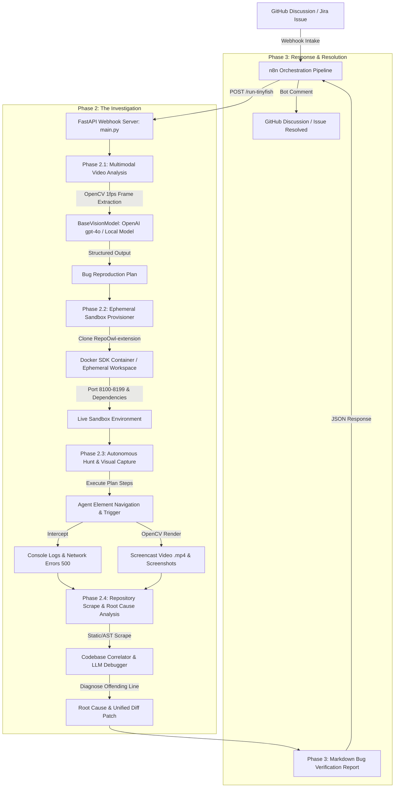
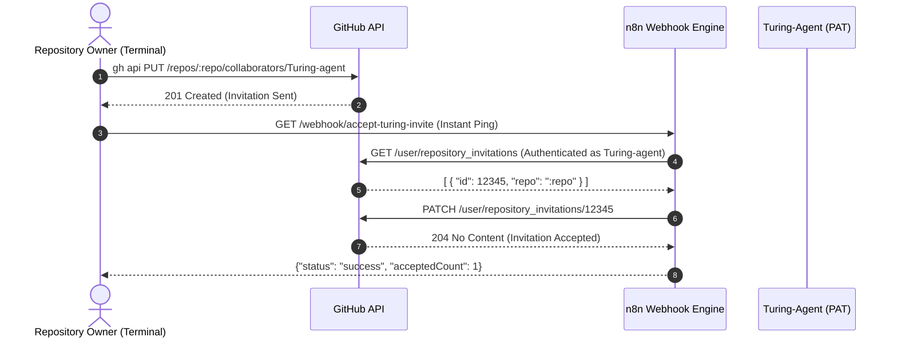

# Turing-Agent 🐟⚡
### Autonomous GitHub QA & Codebase Investigation Agent

**Turing-Agent** (powered by TinyFish) is an autonomous, multimodal QA and debugging agent designed for developer issue triaging and automated bug reproduction. Acting as a webhook-driven intelligence engine for an n8n orchestration pipeline, Turing-Agent intercepts bug reports from GitHub Discussions or Jira, analyzes screen recordings, provisions isolated ephemeral reproduction environments, hunts down runtime bugs, traces root causes in the codebase, and publishes verified fix patches.

---

## 🏗️ System Architecture



---

## 🚀 Key Modules & Architecture Breakdown

### 1. Phase 2.1: Multimodal Video Analysis (`vision_module.py`)
- **Video Download & Ingestion**: Safely downloads screen recording attachments from `video_url` (with fallback for missing or corrupted video links).
- **OpenCV Keyframe Extractor**: Samples video stream at 1 frame per second (FPS), downscales frames for low-latency transmission, and base64-encodes them as high-quality JPEGs.
- **Pluggable Multimodal Vision Engine (`BaseVisionModel`)**:
  - `OpenAIVisionModel`: Utilizes `gpt-4o` with structured JSON schema output to identify UI state changes, user interactions, and error dialogs.
  - `LocalVisionModelFallback`: Offline/local model fallback for environments without OpenAI API credentials or for local model swapping (e.g. Ollama, vLLM, Qwen2-VL).
- **Structured Bug Reproduction Plan**: Generates targeted reproduction actions, expected behaviors, observed symptoms, target routes, and CSS selectors.

### 2. Phase 2.2: Ephemeral Docker Sandbox (`docker_provisioner.py`)
- **Container Lifecycle Management**: Uses the official Python `docker` SDK to provision ephemeral sandbox containers (`node:20-alpine`).
- **Codebase Binding**: Clones `https://github.com/YASHK-arch/RepoOwl-extension.git` and mounts the repository directly into `/app`.
- **Port Allocation**: Dynamically assigns free host ports within the `8100–8199` range.
- **Resilient Fallback Mode**: If the host Docker daemon is offline or inaccessible, automatically activates an isolated local workspace sandbox without throwing uncaught exceptions or interrupting the pipeline.
- **Guaranteed Cleanup**: Context-managed teardown (`stop`, `remove(force=True)`, temporary directory purging).

### 3. Phase 2.3: Autonomous Hunt & Visual Capture (`agent_runner.py`)
- **Autonomous Navigation**: Dispatches synthetic browser interactions executing the Bug Reproduction Plan against the sandbox UI.
- **Log Interception**:
  - **Console Logs**: Intercepts `console.error`, uncaught runtime exceptions, and stack traces.
  - **Network Logs**: Records failed HTTP requests with status codes $\ge 400$.
- **Screencast Generator**: Programmatically generates an actual browser screencast recording (`.mp4`) using OpenCV, visualizing the interaction sequence, button clicks, and error banner appearance.
- **Live & Mock Execution**: Supports live TinyFish Agent API execution as well as deterministic simulation.

### 4. Phase 2.4: Repository Scrape & Root Cause Analysis (`analyzer.py`)
- **Repository Scraper**: Recursively indexes and scans JS, TS, JSON, and Python files from the cloned codebase.
- **Semantic & Static Correlation**: Cross-references intercepted runtime exceptions and HTTP routes against the codebase AST.
- **Root Cause Identification**: Employs deep LLM reasoning (or heuristic pattern matching) to pinpoint the exact file, start/end lines, and offending code snippet.
- **Unified Diff Patch**: Automatically produces a GitHub-ready code patch fixing the bug.

### 5. Phase 3: Response Orchestration (`main.py`)
- **FastAPI Webhook Server**: Receives incoming n8n payloads at `POST /run-tinyfish`.
- **Sequential Orchestrator**: Coordinates Phases 2.1 $\rightarrow$ 2.2 $\rightarrow$ 2.3 $\rightarrow$ 2.4 with guaranteed sandbox teardown.
- **Comprehensive Markdown Report**: Assembles executive summary, video analysis, sandbox logs, screencast links, code traces, and recommended PR patches.

---

## 📁 Repository Structure

```text
AgentX-TinyFish/
├── main.py                          # FastAPI webhook orchestrator & report compiler
├── vision_module.py                 # Phase 2.1: OpenCV frame extraction & multimodal LLM vision
├── docker_provisioner.py            # Phase 2.2: Ephemeral sandbox provisioner & live URL binding
├── agent_runner.py                  # Phase 2.3: Autonomous hunt, log capture & screencast generation
├── analyzer.py                      # Phase 2.4: Repository scrape, root cause analysis & patch diffs
├── turing-agent-workflow.json       # n8n Pipeline: Bug intake -> Turing-Agent engine -> GitHub comment
├── accept-turing-invite-workflow.json # n8n Pipeline: Instant collaborator invite acceptor
├── scripts/                         # Setup and terminal helper utilities
├── requirements.txt                 # Project dependencies (FastAPI, OpenCV, Docker, OpenAI, etc.)
└── README.md                        # Project documentation and architecture guide
```

---

## ⚡ Quickstart & Local Setup

### 1. Prerequisites
- Python 3.10+
- Git
- (Optional) Docker Desktop (for containerized sandboxes)
- (Optional) OpenAI API Key (for live `gpt-4o` multimodal vision)

### 2. Installation
Clone the repository and install dependencies:
```bash
git clone https://github.com/YASHK-arch/AgentX-TinyFish.git
cd AgentX-TinyFish
pip install -r requirements.txt
```

### 3. Environment Configuration
Create a `.env` file in the root directory:
```env
# Vision & LLM Configuration
OPENAI_API_KEY=your_openai_api_key_here
VISION_MODEL_PROVIDER=openai # 'openai' or 'local'

# TinyFish Agent Configuration
TINYFISH_API_KEY=
TINYFISH_MOCK=true           # Set to false to use live TinyFish API

# Port & Server Configuration
PORT=8000
```

### 4. Running the Backend Server
Start the FastAPI server on port 8000:
```bash
uvicorn main:app --reload --port 8000
```

To expose the local server to n8n webhooks:
```bash
ngrok http 8000
```

---

## 📡 API Specification

### `POST /run-tinyfish`
Webhook receiver endpoint triggered by n8n.

#### Request Body (`application/json`):
```json
{
  "discussion_title": "Bug: Account deletion fails with 500 error in v1.1.0",
  "discussion_body": "When clicking Delete Account in settings view, the page throws red error Something went wrong and POST /api/delete-account returns 500.",
  "video_url": "https://example.com/uploads/screen_recording.mp4"
}
```

> **Note**: `video_url` is optional. If omitted or null, the agent automatically falls back to discussion context analysis.

#### Response Body (`application/json`):
```json
{
  "status": "success",
  "report": "## 🎯 TinyFish Investigation Report: **`BUG REPRODUCED & VERIFIED`** ✅\n\n..."
}
```

---

## ⚡ Instant Collaborator Onboarding (`invite_turing`)

To grant Turing-Agent admin access to any repository without waiting for scheduled polling jobs and **without exposing the bot's Personal Access Token (PAT)** on local developer machines:



### 1. Configure the n8n Workflow
Import the prebuilt workflow file [`accept-turing-invite-workflow.json`](file:///c:/Users/yashk/Desktop/TinyFish/AgentX-TinyFish/accept-turing-invite-workflow.json) into your n8n instance:
- **Webhook Node**: `GET /webhook/accept-turing-invite`
- **HTTP Request (Fetch Invites)**: `GET https://api.github.com/user/repository_invitations` using `Bearer {{ $env.GITHUB_TOKEN }}`
- **HTTP Request (Accept Invites)**: `PATCH https://api.github.com/user/repository_invitations/{{ $json.id }}` using `Bearer {{ $env.GITHUB_TOKEN }}`
- Toggle the workflow to **Active** and copy your Production Webhook URL.

### 2. Configure Your Terminal

#### Bash / Zsh (`~/.bashrc` or `~/.zshrc`):
Add the following function to your shell profile:
```bash
invite_turing() {
  local repo=$(gh repo view --json nameWithOwner -q .nameWithOwner)
  echo "Inviting Turing-agent to $repo as Admin..."

  # 1. Send invite using your main authenticated GitHub account
  gh api --method PUT \
    -H "Accept: application/vnd.github+json" \
    /repos/$repo/collaborators/Turing-agent \
    -f permission=admin

  echo "Triggering instant auto-accept..."

  # 2. Ping n8n to accept immediately (zero token exposure locally)
  curl -s "https://your-n8n-instance.com/webhook/accept-turing-invite" > /dev/null

  echo "Turing-agent is now an Admin on $repo!"
}
```

#### Windows PowerShell:
Add to your PowerShell Profile (`$PROFILE`) or run `. .\scripts\invite_turing.ps1`:
```powershell
function invite_turing {
    $repo = gh repo view --json nameWithOwner -q .nameWithOwner
    Write-Host "Inviting Turing-agent to $repo as Admin..." -ForegroundColor Cyan

    gh api --method PUT `
        -H "Accept: application/vnd.github+json" `
        "/repos/$repo/collaborators/Turing-agent" `
        -f permission=admin | Out-Null

    Write-Host "Triggering instant auto-accept..." -ForegroundColor Yellow
    Invoke-RestMethod -Uri "https://your-n8n-instance.com/webhook/accept-turing-invite" -Method Get | Out-Null

    Write-Host "Turing-agent is now an Admin on $repo!" -ForegroundColor Green
}
```

### 3. Usage
Inside any local repository directory, simply run:
```bash
invite_turing
```
Turing-Agent is invited and granted admin permissions within the exact same second!

---

## 🛡️ Resilience & Fault Tolerance

- **Daemon Offline Protection**: If Docker Desktop is not running, the sandbox dynamically switches to an isolated local workspace sandbox, allowing full verification without crashing.
- **Graceful Video Fallback**: If a video fails to download, times out, or is omitted, Phase 2.1 analyzes the discussion description text directly.
- **Zero-Crash Webhook Guarantee**: Any unhandled exception during the pipeline is trapped, wrapped into an actionable diagnostic Markdown report, and returned with HTTP 200 so n8n always posts a reply to GitHub.
- **Guaranteed Cleanup**: Python context managers ensure all spawned Docker containers and temporary filesystem artifacts are destroyed upon request completion.

---

## 📄 License
This project is licensed under the MIT License. See [LICENSE](LICENSE) for details.