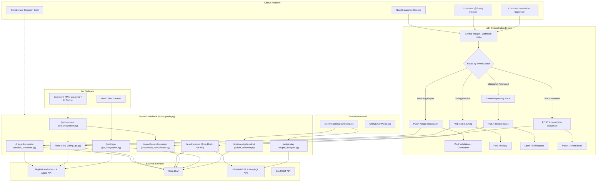

# Turing-Agent 🐟

<table>
  <tr>
    <td width="75%" valign="top">
      <p><strong>Autonomous GitHub QA maintainer, code repair agent, and repository intelligence system</strong></p>
      <p>
        Turing-Agent is a Python/FastAPI service that integrates with <a href="https://n8n.io/">n8n</a>, <a href="https://github.com/">GitHub</a>, and <a href="https://www.atlassian.com/software/jira">Jira</a> to automate bug triage, cross-issue correlation, semantic regression detection, and AI-assisted code fixes. Powered by <strong>TinyFish</strong> web automation and <strong>Groq</strong> LLM inference.
      </p>
    </td>
    <td width="25%" align="center" valign="middle">
      
    </td>
  </tr>
</table>

> **Implementation status:** This repository includes both live API integrations and simulated/fallback behavior. A generated investigation report or patch is **not automatically proof that a bug was reproduced, a fix was tested, or a pull request was opened**. See [Current limitations](#current-limitations) before using this system for production automation.

## Contents

- [Architecture](#architecture)
- [Features and modules](#features-and-modules)
- [Repository layout](#repository-layout)
- [Prerequisites](#prerequisites)
- [Local setup](#local-setup)
- [Configuration](#configuration)
- [API reference](#api-reference)
- [n8n integration](#n8n-integration)
- [Jira integration](#jira-integration)
- [Git regression dashboard](#git-regression-dashboard)
- [Collaborator invitation workflow](#collaborator-invitation-workflow)
- [Current limitations](#current-limitations)
- [Development and troubleshooting](#development-and-troubleshooting)
- [License](#license)

## Architecture



## Features and modules

| Component | Responsibility | File |
| --- | --- | --- |
| API orchestrator | FastAPI routes, all endpoints, Git operations | `main.py` |
| Intent parser & QA | Groq intent classification, TinyFish investigation, related issues | `tasks/turing_qa.py` |
| TinyFish correlator | Scrapes GitHub issues/discussions, cross-issue correlation | `tasks/tinyfish_correlator.py` |
| Discussion consolidator | Synthesizes discussion threads into clean GitHub Issue specs | `tasks/discussion_consolidator.py` |
| Jira integration | Jira queue scraping, internal notes, interactive commands | `tasks/jira_integration.py` |
| Culprit analyzer | Git DAG construction, incident pinning, semantic regression detection | `tasks/culprit_analyzer.py` |
| Agent runner | TinyFish browser automation, screenshot capture | `tasks/agent_runner.py` |
| Root-cause analyzer | Source inspection, AST analysis, patch proposals | `tasks/analyzer.py` |
| Sandbox provisioner | Docker container management, repo cloning | `tasks/docker_provisioner.py` |
| Vision module | Video frame extraction, reproduction planning | `tasks/vision_module.py` |
| React dashboard | Git DAG visualization, culprit investigation panel | `frontend/src/components/GitTimeSeriesDashboard.jsx` |
| n8n GitHub workflow | GitHub webhook handling, routing, comment posting | `turing-agent-workflow.json` |
| n8n invite workflow | Collaborator invitation acceptance | `accept-turing-invite-workflow.json` |

### Core workflows

#### 1. Discussion triage (`POST /triage-discussion`)
- Generates immediate maintainer validation comment via Groq LLM
- Scrapes repository issues/discussions via TinyFish Web Fetch API
- Correlates related issues, PRs, and component impacts
- Posts threaded TinyFish correlation report under validation comment

#### 2. Intent-driven Q&A (`POST /chat-turing`)
- Classifies comments into: `FIND_RELATED_ISSUES`, `REPRODUCE_BUG`, `ANALYZE_PROPOSAL`, `GENERAL_QA`
- Handles bug reproduction via TinyFish browser automation with screenshots
- Scrapes related issues and conflicting PRs
- Analyzes contributor proposals for trade-offs and drawbacks

#### 3. Maintainer approval & PR resolution (`POST /resolve-issue`)
- Creates GitHub issue with `ready-for-work` label
- Posts real-time progress checklist in discussion
- Fetches repository files in parallel (ThreadPoolExecutor)
- Inspects live deployments via TinyFish Agent
- Generates code fixes via Groq LLM
- Commits changes via GitHub Git Data API with co-author credit
- Opens Pull Request with rich description and TinyFish screenshots

#### 4. Discussion consolidation (`POST /consolidate-discussion`)
- Triggered by maintainer `RW` command
- Fetches discussion thread comments
- Synthesizes consensus into clean GitHub Issue spec via Groq
- Patches existing issue with consolidated title and body
- Enforces 2,500 character token safety limit

#### 5. Cleaned-issue follow-up monitoring (TinyFish)
- Once an `RW` command has created or updated a cleaned-up GitHub issue, TinyFish monitors that issue for further conversation.
- If follow-up discussion occurs, a 24-hour timer runs before the additional context is consolidated.
- When the timer expires, the cleaned-up context is automatically attached as a sub-issue to the existing cleaned-up issue in GitHub Issues.

#### 6. Jira integration
- **Triage** (`POST /jira/triage`): Posts maintainer validation + TinyFish correlation as INTERNAL NOTE
- **Comment handling** (`POST /jira/comment`): Processes `RW`, `approved`, and `Hi Turing` commands
- Creates GitHub Issues with `source: Jira` label
- Tracks source provenance via labels

#### 7. Git regression intelligence
- **Git DAG** (`GET /api/git-dag`): Fetches commit DAG with incidents pinned to timeline
- **Culprit detection** (`POST /api/investigate-culprit`): Semantic regression analysis to identify guilty commit
- Visualizes swimlane graph with authentic Git branch rendering
- Maps issues/discussions to closest prior commit by timestamp
- Syncs upstream issue metadata for mirrored issues

## Repository layout

```text
.
├── .agents/
│   ├── mcp_config.json                 # n8n MCP endpoint configuration
│   └── skills/
│       └── reproduce-bug-report/      # Oz cloud agent skill
├── tasks/                              # Modular task modules
│   ├── __init__.py
│   ├── turing_qa.py                    # Intent parser & QA engine
│   ├── tinyfish_correlator.py         # TinyFish scraper & correlator
│   ├── discussion_consolidator.py    # Discussion consolidation
│   ├── jira_integration.py            # Jira integration
│   ├── culprit_analyzer.py           # Git regression intelligence
│   ├── agent_runner.py               # TinyFish browser automation
│   ├── analyzer.py                   # Root-cause analysis
│   ├── docker_provisioner.py          # Docker sandbox management
│   └── vision_module.py               # Video analysis
├── frontend/                          # React dashboard
│   ├── src/
│   │   ├── components/
│   │   │   ├── GitTimeSeriesDashboard.jsx
│   │   │   └── GitHubAuthModal.jsx
│   │   ├── main.jsx
│   │   └── styles.css
│   └── dist/                          # Built frontend assets
├── scripts/                           # Utility scripts
│   ├── invite_turing.sh               # Bash invitation helper
│   ├── invite_turing.ps1              # PowerShell invitation helper
│   ├── diff_cloud_workflow.py
│   ├── n8n_mcp_client.py
│   ├── retrigger_discussions.py
│   ├── switch_backend_url.py
│   ├── sync_upstream_issues.py
│   ├── sync_workflow_to_cloud.py
│   ├── test_jira_converter.py
│   └── test_jira_flow.py
├── main.py                            # FastAPI application
├── turing-agent-workflow.json         # n8n GitHub workflow
├── accept-turing-invite-workflow.json # n8n invitation workflow
├── requirements.txt                   # Python dependencies
├── project_context.md                 # Detailed architecture documentation
├── tasks.md                           # Development tasks
├── README.md
└── LICENSE
```

## Prerequisites

- Python **3.10+** and `pip` (a virtual environment is recommended)
- Git for cloning repositories
- Docker Desktop / an accessible Docker daemon **optional**, for containerized investigation
- Node.js 18+ and npm for frontend development
- API credentials as needed for specific integrations (see below)
- For n8n: an n8n instance that can reach the FastAPI backend
- For invitation helpers: [GitHub CLI (`gh`)](https://cli.github.com/)

## Local setup

1. Clone the repository:

   ```bash
   git clone https://github.com/Turing-agent/Turing-agent.git
   cd Turing-agent
   ```

2. Create a virtual environment and install Python dependencies:

   ```bash
   python3 -m venv .venv
   source .venv/bin/activate  # macOS / Linux
   # On Windows PowerShell: .venv\Scripts\Activate.ps1
   pip install -r requirements.txt
   ```

3. Configure environment variables in `.env`:

   ```dotenv
   # Groq LLM (required for triage and fix generation)
   GROQ_API_KEY=gsk_...
   GROQ_MODEL=openai/gpt-oss-120b

   # TinyFish (optional for live investigation)
   TINYFISH_API_KEY=sk-tinyfish-...
   TINYFISH_MOCK=false

   # GitHub (required for API operations)
   GITHUB_TOKEN=ghp_...

   # Jira (optional for Jira integration)
   JIRA_EMAIL=user@company.com
   JIRA_API_TOKEN=...
   JIRA_URL=https://company.atlassian.net
   ```

4. Launch the backend:

   ```bash
   uvicorn main:app --reload --host 127.0.0.1 --port 8000
   ```

5. (Optional) Build and serve the frontend:

   ```bash
   cd frontend
   npm install
   npm run build
   cd ..
   # Frontend will be served at http://127.0.0.1:8000/dashboard
   ```

6. Verify health endpoint:

   ```bash
   curl http://127.0.0.1:8000/
   ```

   Interactive FastAPI docs are available at `http://127.0.0.1:8000/docs`

## Configuration

| Variable | Used by | Requirement / default |
| --- | --- | --- |
| `GROQ_API_KEY` | Triage, fix generation, QA, culprit detection | Required |
| `GROQ_MODEL` | Groq LLM calls | Optional; falls back to `openai/gpt-oss-120b` |
| `TINYFISH_API_KEY` | TinyFish web automation, issue scraping | Optional for simulated mode |
| `TINYFISH_MOCK` | TinyFish agent runner | Defaults to `true`; set `false` for live automation |
| `GITHUB_TOKEN` | GitHub API operations | Required for authenticated operations |
| `JIRA_EMAIL` | Jira REST API authentication | Optional for Jira integration |
| `JIRA_API_TOKEN` | Jira REST API authentication | Optional for Jira integration |
| `JIRA_URL` | Jira instance base URL | Optional; defaults to `https://jira.atlassian.net` |

## API reference

### Core endpoints

| Method | Path | Purpose |
| --- | --- | --- |
| `GET` | `/` | Health check |
| `GET` | `/dashboard` | React dashboard |
| `POST` | `/triage-discussion` | Generate validation + correlation comments |
| `POST` | `/chat-turing` | Intent-driven Q&A and investigation |
| `POST` | `/resolve-issue` | Generate code fixes and create PR |
| `POST` | `/consolidate-discussion` | Synthesize discussion into clean issue spec |
| `GET/POST` | `/accept-turing-invite` | Accept GitHub collaborator invitations |
| `POST` | `/jira/triage` | Triage Jira ticket with internal notes |
| `POST` | `/jira/comment` | Handle Jira ticket commands |
| `GET` | `/api/git-dag` | Fetch Git DAG with incidents |
| `POST` | `/api/investigate-culprit` | Perform semantic regression analysis |

### `POST /triage-discussion`

```bash
curl -X POST http://127.0.0.1:8000/triage-discussion \
  -H 'Content-Type: application/json' \
  -d '{
    "discussion_title": "Bug: login redirect fails",
    "discussion_body": "After logging in, the application remains on the sign-in screen.",
    "discussion_number": 17,
    "author": "example-user",
    "repository": "OWNER/REPO"
  }'
```

Response:
```json
{
  "status": "success",
  "validation_comment": "Hey @example-user! 👋 Thanks for reporting...",
  "tinyfish_correlation_comment": "<!-- turing-bot -->\n## 🐟 TinyFish Cross-Issue Correlation...",
  "scraped_issues_count": 3
}
```

### `POST /resolve-issue`

```bash
curl -X POST http://127.0.0.1:8000/resolve-issue \
  -H 'Content-Type: application/json' \
  -d '{
    "issue_title": "Fix incorrect login redirect",
    "issue_body": "Steps to reproduce...",
    "issue_number": 17,
    "repo_full_name": "OWNER/REPO",
    "base_tree_sha": "REPLACE_WITH_REAL_GIT_TREE_SHA",
    "author": "contributor"
  }'
```

Response:
```json
{
  "status": "success",
  "commit_sha": "new-commit-sha",
  "tree_sha": "new-tree-sha",
  "branch_name": "issue-17",
  "commit_message": "fix: resolve issue #17",
  "summary": "1-2 sentence explanation",
  "changes": [
    {"path": "src/example.js", "content": "..."}
  ],
  "files_changed": 1,
  "changed_paths": ["src/example.js"],
  "files_analyzed": 15
}
```

### `GET /api/git-dag`

```bash
curl "http://127.0.0.1:8000/api/git-dag?repo=OWNER/REPO&limit=30"
```

Response:
```json
{
  "repository": "OWNER/REPO",
  "default_branch": "main",
  "total_commits": 30,
  "commits": [
    {
      "sha": "abc123...",
      "short_sha": "abc1234",
      "message": "Fix navbar navigation",
      "author": "dev",
      "date": "2026-10-31T10:00:00Z",
      "lane": 0,
      "lane_color": "#38bdf8",
      "incidents": [...]
    }
  ],
  "incidents": [...]
}
```

## n8n integration

### GitHub Discussions workflow

Import [`turing-agent-workflow.json`](turing-agent-workflow.json) into n8n:

1. **GitHub Trigger**: Receives `discussion` and `discussion_comment` events
2. **Route by Event Switch**:
   - **New Bug Report**: Acknowledge with 👀 → triage → post validation + correlation
   - **Turing Chat**: Check for mention → call `/chat-turing` → post reply
   - **Maintainer Approved**: Create issue → post progress → call `/resolve-issue` → open PR
   - **RW Command**: Call `/consolidate-discussion` → patch issue
   - **Cleaned-issue follow-up**: TinyFish monitors an existing issue created or cleaned up through `RW`. When new conversation is detected, after a 24-hour timer it consolidates that follow-up context and attaches it as a sub-issue to the cleaned-up issue in GitHub Issues.

### Invitation workflow

Import [`accept-turing-invite-workflow.json`](accept-turing-invite-workflow.json):

1. **Webhook trigger**: `GET /webhook/accept-turing-invite`
2. **Fetch invitations**: Query GitHub API for pending invites
3. **Accept invitations**: Accept each pending invite via PATCH

## Jira integration

Turing-Agent integrates with Jira Software for enterprise ticket triage:

### Capabilities

- **Queue Scraping**: Fetches open Jira tickets via REST API or TinyFish
- **Internal Notes**: Posts maintainer validation + TinyFish correlation as INTERNAL NOTE (private to maintainers)
- **Interactive Commands**:
  - `RW`: Creates GitHub Issue with `source: Jira` label
  - `approved`: Triggers automated PR fix workflow
  - `Hi Turing, ...`: Dispatches through intent layer for Q&A
- **Source Provenance**: Tracks ticket origin via labels (`source: Jira`, `source: GitHub Discussion`)

### Endpoints

- `POST /jira/triage`: Triages a Jira ticket with maintainer validation
- `POST /jira/comment`: Handles interactive commands on Jira tickets

## Git regression dashboard

The React dashboard (`frontend/src/components/GitTimeSeriesDashboard.jsx`) provides:

### Features

1. **Interactive Git Graph Visualization**
   - Authentic swimlane rendering (GitKraken/VS Code style)
   - Branch color coding and merge arc visualization
   - Tag and branch reference pills

2. **Incident Pinning**
   - Maps GitHub issues and discussions to commits by timestamp
   - Red defect markers on commits with incidents
   - Expandable incident dropdowns per commit

3. **Culprit Investigation**
   - One-click semantic regression analysis
   - Groq LLM reasoning for commit blame
   - Confidence scoring and explanation

4. **GitHub Authentication**
   - OAuth integration for private repo access
   - Demo mode for public repositories

5. **Repository Selection**
   - Pre-configured repos (eventyaysandbox/eventyay_Sandbox, fossasia/eventyay, etc.)
   - Dynamic user repo fetching via GitHub API

### Access

Visit `http://127.0.0.1:8000/dashboard` when the backend is running, or deploy the frontend with `npm run build` in the `frontend/` directory.

## Collaborator invitation workflow

The helper scripts use `gh` to invite `Turing-agent` and trigger the n8n webhook:

**Bash/Zsh:**
```bash
export TURING_N8N_INVITE_WEBHOOK='https://YOUR_N8N_HOST/webhook/accept-turing-invite'
source scripts/invite_turing.sh
invite_turing
```

**PowerShell:**
```powershell
$env:TURING_N8N_INVITE_WEBHOOK = 'https://YOUR_N8N_HOST/webhook/accept-turing-invite'
. .\scripts\invite_turing.ps1
Invite-Turing
```

**Before using:** Confirm that `Turing-agent` is the correct account and that your team approves granting it access.

## Current limitations

1. **Simulated investigation**: `TINYFISH_MOCK=true` (default) generates canned reports. Live TinyFish automation requires a valid API key.
2. **LLM hallucinations**: Groq-generated code fixes require human review before merging.
3. **Token limits**: Discussion consolidation enforces 2,500 character limit for LLM safety.
4. **Docker requirement**: Sandbox provisioning requires Docker; falls back to temporary workspace if unavailable.
5. **GitHub API rate limits**: High-volume operations may hit rate limits; implement backoff/retry logic as needed.

## Development and troubleshooting

### Running tests

```bash
# Run Python tests (if available)
pytest

# Run frontend tests
cd frontend
npm test
```

### Building the frontend

```bash
cd frontend
npm install
npm run build
```

### Debugging

- Enable debug logging by setting `LOG_LEVEL=DEBUG` in `.env`
- Check FastAPI docs at `http://127.0.0.1:8000/docs` for interactive API testing
- Monitor n8n workflow execution logs in the n8n UI

### Common issues

- **Import errors**: Ensure `tasks/` directory is in `sys.path` (handled in `main.py`)
- **Groq rate limits**: The code implements backoff retries; adjust `GROQ_MODEL` if needed
- **TinyFish timeout**: Increase timeout in `agent_runner.py` if automation takes longer
- **GitHub authentication**: Verify `GITHUB_TOKEN` has required permissions (repo, issues, pull requests)

## License

See [LICENSE](LICENSE) file for details.

---

*Autonomous QA powered by TinyFish & Groq LLM*
