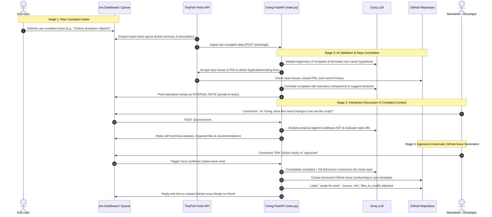
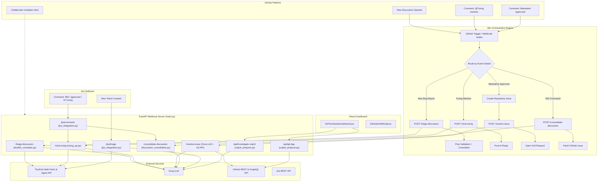

<div align="center">

  <h1 align="center">Turing-Agent 🐟</h1>

[](https://python.org)
[](https://fastapi.tiangolo.com)
[](https://react.dev)
[](https://vitejs.dev)
[](https://groq.com)
[](https://tinyfish.ai)
[](LICENSE)
[](CONTRIBUTING.md)
[](#-welcome-osc-contributors--hackers)

### **From Raw User Complaints to Implementation-Ready GitHub Issues**

*An AI-powered QA bridge connecting customer complaint dashboards (Jira) directly to the codebase.*

<br/>

<table>
  <tr>
    <td width="70%" valign="top">
      <p>
        <strong>Turing-Agent</strong> automates the entire journey from raw end-user complaints to validated, discussed, and implementation-ready GitHub issues.
      </p>
      <p>
        End users file raw, unstructured complaint tickets in issue trackers like <strong>Jira</strong> that lack code context. <strong>Turing-Agent</strong> uses <strong>TinyFish</strong> to extract these raw tickets, validates whether each complaint is legitimate, pinpoints which parts of the repository are affected, suggests potential fixes, and cross-checks existing open issues to avoid duplicate work.
      </p>
      <p>
        It provides an <strong>interactive AI-powered QA interface</strong> where maintainers and developers can discuss potential solutions in the context of the complaint. Once approved (<code>RW</code> / <code>approved</code>), Turing automatically synthesizes the complete discussion into a clean, standardized <strong>GitHub issue</strong> conforming to repository issue templates—complete with agreed implementation scope, relevant patches, and acceptance criteria.
      </p>
    </td>
    <td width="30%" align="center" valign="middle">
      
      <br/>
      <sub><em>Turing-Agent: Complaint-to-Issue Bridge 🐟</em></sub>
    </td>
  </tr>
</table>

</div>

---

## 📑 Table of Contents

- [🎯 Core Project Intent & The Problem We Solve](#-core-project-intent--the-problem-we-solve)
- [🔄 The End-to-End Journey (Raw Complaint ➔ GitHub Issue)](#-the-end-to-end-journey-raw-complaint--github-issue)
- [🎪 Welcome OSC Contributors & Hackers!](#-welcome-osc-contributors--hackers)
  - [Why Hack on Turing-Agent at the OSC Event?](#why-hack-on-turing-agent-at-the-osc-event)
  - [5-Minute Zero-Barrier Setup (Local Mock Mode)](#5-minute-zero-barrier-setup-local-mock-mode)
  - [OSC Contribution Tracks & Good First Issues](#osc-contribution-tracks--good-first-issues)
- [⚡ Quick Try: 1-Command Universal Installation](#-quick-try-1-command-universal-installation)
- [🏛️ Architecture](#architecture)
- [📦 Features and modules](#features-and-modules)
- [🖥️ Interactive QA & Git Regression Dashboard](#️-interactive-qa--git-regression-dashboard)
- [📦 Repository Layout & Modules](#-repository-layout--modules)
- [🛠️ Local Development & Testing Guide](#️-local-development--testing-guide)
- [⚙️ Configuration & Environment Variables](#️-configuration--environment-variables)
- [📡 API Reference](#-api-reference)
- [🛡️ Safety Guardrails & Human-in-the-Loop Governance](#️-safety-guardrails--human-in-the-loop-governance)
- [🤝 Contributing Guidelines](#-contributing-guidelines)
- [📄 License & Community](#-license--community)

---

## 🎯 Core Project Intent & The Problem We Solve

### The Problem: The Disconnect Between Complaints and Code
In most software organizations and open-source projects, there is a painful wall between **customer-facing complaint systems (like Jira Service Management)** and the **engineering codebase (GitHub)**:

1. **Raw, Unstructured Tickets**: End users write vague symptoms: *"The button stopped working"* or *"Dropdown is broken on mobile"*. They have no awareness of repository architecture, components, or logs.
2. **Manual Triage Burden**: Maintainers and engineers spend hours manually:
   - Verifying whether a complaint is a legitimate bug or user error.
   - Searching the repository to guess which files, components, or services are affected.
   - Checking whether an existing open issue or PR already addresses the complaint.
3. **Lost Consensus**: Developers and maintainers debate potential solutions in ticket comments or chat threads, but that consensus gets lost or has to be manually transcribed into a clean GitHub issue.
4. **Poor Issue Quality**: Issues created manually from complaints often lack proper scope, file boundaries, and acceptance criteria, causing delays and confusion for contributors trying to implement fixes.

---

### The Solution: Turing-Agent's Multi-Platform QA Bridge
**Turing-Agent** is conceived as a multi-platform solution (specifically demonstrated and scoped around **Jira** for the hackathon/OSC event) that completely automates the journey:

```
┌─────────────────────────┐
│ Raw User Complaint      │  (e.g., Jira Service Management ticket)
└────────────┬────────────┘
             │  1. Ingestion via TinyFish Web Fetch / API
             ▼
┌─────────────────────────┐
│ AI Validation & Triage  │  • Is the complaint legitimate?
│                         │  • Which repository files/components are affected?
│                         │  • What are possible solution patterns?
│                         │  • Does an existing open issue already solve it?
└────────────┬────────────┘
             │  2. Internal Maintainer Review posted to Jira
             ▼
┌─────────────────────────┐
│ Interactive QA Bridge   │  • Maintainers & developers discuss fixes with the agent
│                         │  • Chat in the context of the complaint (`Hi Turing, ...`)
│                         │  • Agree on implementation scope & architectural trade-offs
└────────────┬────────────┘
             │  3. Maintainer Approval Command (`RW` / `approved`)
             ▼
┌─────────────────────────────────────────────────────────────┐
│ Implementation-Ready GitHub Issue Generated                │
│                                                             │
│ • Refined description conforming to repo issue template    │
│ • Complete discussion consensus and trade-off summary       │
│ • Agreed implementation scope (exact `files_to_modify`)     │
│ • Relevant patches, proposed diffs & acceptance criteria    │
│ • Labeled `ready-for-work` and `source: Jira`               │
└─────────────────────────────────────────────────────────────┘
```

---

## 🔄 The End-to-End Journey (Raw Complaint ➔ GitHub Issue)



---

### The 4 Stages in Detail

#### 1. Raw Ticket Extraction (TinyFish)
- TinyFish actively scrapes raw complaint queues from end-user applications (Jira Service Management, customer support portals, or discussion boards).
- No manual ticket forwarding is needed—the ingestion engine pulls raw summaries and descriptions automatically.

#### 2. Legitimacy Validation & Repository Correlation
- **Legitimacy Check**: The agent determines whether the complaint is a reproducible technical issue, a known limitation, or user error.
- **Affected Repository Scope**: Pinpoints which frontend or backend components in the codebase are responsible (e.g. `src/components/UsersTable.jsx`, CSS overflow rules).
- **Solution Suggestions**: Formulates actionable engineering proposals and architectural approaches.
- **Cross-Issue Deduplication**: TinyFish cross-checks the target GitHub repository's open issues, closed issues, and merged PRs to detect if an active effort already solves the problem, avoiding duplicate engineering effort.
- **Private Maintainer Note**: Attaches this analysis directly to Jira as an **Internal Note** (visible only to maintainers and developers, not end users).

#### 3. Interactive QA Bridge (Discussing in Context)
- Developers and maintainers don't have to leave Jira to inspect the code.
- They can directly converse with Turing in the ticket comments:
  - *"Hi Turing, can we resolve this by changing the modal z-index instead?"*
  - *"Which files would be affected if we refactor the route handler?"*
- Turing answers grounded in the repository's actual code structure and AST, evaluating technical trade-offs before any code is touched.

#### 4. Automatic Conversion to Implementation-Ready GitHub Issue (`RW` / `approved`)
- When the team reaches consensus, a maintainer issues an approval command (`RW` or `approved`).
- Turing automatically converts the entire journey into a clean, standardized **GitHub Issue**:
  - **Standard Issue Template**: Structured with Problem Statement, Motivation, Agreed Decisions, and Acceptance Criteria checkboxes.
  - **Cleaned-Up Specification**: Strips informal conversational banter and typos, synthesizing the core technical consensus.
  - **Explicit File Scope**: Generates `files_to_modify` so developers picking up the issue know exactly where to make changes.
  - **Relevant Patches**: Includes code snippets or unified diff suggestions where applicable.
  - **Provenance Tracking**: Labeled with `ready-for-work` and `source: Jira`.

---

## 🎪 Welcome OSC Contributors & Hackers!

If you are joining us at an **Open Source Community (OSC) event, hackathon, or sprint**, welcome! 

### Why Hack on Turing-Agent at the OSC Event?
- 🎯 **A Real, Underserved Problem**: You're building a solution to the real-world gap between user complaint tickets and engineering backlogs.
- ⚡ **Modern Agentic Stack**: FastAPI, Groq high-speed LLM inference, TinyFish web automation, React 19, and GitHub/Jira REST & GraphQL APIs.
- 🆓 **Zero-Cost Local Hacking**: You do **not** need paid API keys! The built-in **Local Mock Mode (`TINYFISH_MOCK=true`)** and free Groq keys let you hack immediately on your laptop without any barriers.

---

### 5-Minute Zero-Barrier Setup (Local Mock Mode)

#### 1. Clone the repository
```bash
git clone https://github.com/Turing-agent/Turing-agent.git
cd Turing-agent
```

#### 2. Set up Python virtual environment
```bash
python -m venv .venv

# On Linux / macOS:
source .venv/bin/activate

# On Windows PowerShell:
.\.venv\Scripts\Activate.ps1

pip install -r requirements.txt
```

#### 3. Configure `.env` (Ready for Mock Mode!)
Create a `.env` file in the root directory:
```dotenv
# Groq LLM (Get a free instant key from https://console.groq.com)
GROQ_API_KEY=gsk_your_free_groq_key
GROQ_MODEL=openai/gpt-oss-120b

# TinyFish (Set mock=true to develop locally without paid credits!)
TINYFISH_MOCK=true
TINYFISH_API_KEY=mock-dev-key

# GitHub Token (Optional for read-only local testing; required for live issue creation)
GITHUB_TOKEN=ghp_your_github_pat

# Jira Configuration (Optional; mock fallback included)
JIRA_EMAIL=user@company.com
JIRA_API_TOKEN=your_token
JIRA_URL=https://company.atlassian.net
```

#### 4. Launch the FastAPI Backend
```bash
uvicorn main:app --reload --host 127.0.0.1 --port 8000
```
Open **[http://127.0.0.1:8000/docs](http://127.0.0.1:8000/docs)** to test all triage, chat, and issue-synthesis endpoints interactively.

#### 5. Launch the React Dashboard
In a separate terminal:
```bash
npm install
npm run dev
```
Open **[http://localhost:5173](http://localhost:5173)** to explore the Git timeline and QA interface.

#### 6. Run the Jira Integration Tests
```bash
python scripts/test_jira_flow.py
```
*(Runs full test suite verifying Jira queue scraping, maintainer triage, `RW` issue creation, and wiki markup conversion!)*

---

### OSC Contribution Tracks & Good First Issues

| Track | Goal & Scope | Key Files |
| :--- | :--- | :--- |
| 📋 **Track 1: Issue Template & Synthesis Intelligence** | • Teach the consolidator to parse and match specific `.github/ISSUE_TEMPLATE/*.md` formats<br/>• Improve Groq prompts for extracting precise acceptance criteria<br/>• Enhance patch suggestion generation | `tasks/discussion_consolidator.py`<br/>`tasks/tinyfish_correlator.py` |
| 🌉 **Track 2: Multi-Platform Support (Beyond Jira)** | • Add adapters for **Linear**, **Zendesk**, **GitLab Issues**, or **GitHub Discussions**<br/>• Build webhook receivers for customer feedback platforms<br/>• Unify raw complaint ingestion schemas | `tasks/jira_integration.py`<br/>`main.py`<br/>`scripts/` |
| 🔍 **Track 3: Codebase AST & Duplicate Detection** | • Improve component mapping so complaints map to exact file paths and line ranges<br/>• Smarter deduplication: semantic matching between complaints and open GitHub issues<br/>• Blast-radius estimation for proposed fixes | `tasks/analyzer.py`<br/>`tasks/tinyfish_correlator.py`<br/>`tasks/culprit_analyzer.py` |
| 📊 **Track 4: QA Dashboard & Visual Interface** | • Add a "Complaint Intake Queue" view in the React dashboard<br/>• Real-time diff previews for suggested patches<br/>• Direct "Approve & Convert to GitHub Issue" button in the dashboard UI | `frontend/src/components/GitTimeSeriesDashboard.jsx`<br/>`frontend/src/` |
| 🧪 **Track 5: Tests, Documentation & Demos** | • Expand pytest test coverage for edge cases (e.g. malformed complaints)<br/>• Create a sample interactive walkthrough or video demo for maintainers<br/>• Dockerize the full stack for one-command setup | `scripts/test_jira_flow.py`<br/>`Dockerfile`<br/>`README.md` |

---

## ⚡ Quick Try: 1-Command Universal Installation

Want to connect Turing-Agent to your open-source repository right now? Any maintainer can initialize Turing in 30 seconds using a single command:

### Option A: Cross-Platform NPX
```bash
npx github:Turing-agent/Turing-agent
```
*Or target any remote repository directly:*
```bash
npx github:Turing-agent/Turing-agent owner/repo
```

### Option B: Linux / macOS 1-Liner (curl)
```bash
curl -fsSL https://raw.githubusercontent.com/Turing-agent/Turing-agent/main/scripts/install.sh | bash
```

### Option C: Windows PowerShell 1-Liner
```powershell
irm https://raw.githubusercontent.com/Turing-agent/Turing-agent/main/scripts/install.ps1 | iex
```

---

## Architecture



## Features and modules

| Component | Responsibility | File |
| --- | --- | --- |
| API orchestrator | FastAPI routes, all endpoints, Git operations | `main.py` |
| Intent parser & QA | Groq intent classification, TinyFish investigation, related issues | `tasks/turing_qa.py` |
| TinyFish correlator | Scrapes GitHub issues/discussions, cross-issue correlation | `tasks/tinyfish_correlator.py` |
| Discussion consolidator | Synthesizes discussion threads into clean GitHub Issue specs | `tasks/discussion_consolidator.py` |
| Jira integration | Jira queue scraping, internal notes, interactive commands | `tasks/jira_integration.py` |
| Culprit analyzer | Git DAG construction, incident pinning, semantic regression detection | `tasks/culprit_analyzer.py` |
| Agent runner | TinyFish browser automation, screenshot capture | `tasks/agent_runner.py` |
| Root-cause analyzer | Source inspection, AST analysis, patch proposals | `tasks/analyzer.py` |
| Sandbox provisioner | Docker container management, repo cloning | `tasks/docker_provisioner.py` |
| Vision module | Video frame extraction, reproduction planning | `tasks/vision_module.py` |
| React dashboard | Git DAG visualization, culprit investigation panel | `frontend/src/components/GitTimeSeriesDashboard.jsx` |
| n8n GitHub workflow | GitHub webhook handling, routing, comment posting | `turing-agent-workflow.json` |
| n8n invite workflow | Collaborator invitation acceptance | `accept-turing-invite-workflow.json` |

---

## 🖥️ Interactive QA & Git Regression Dashboard

The repository includes a dedicated React 19 / TailwindCSS dashboard (`frontend/`) accessible at `http://127.0.0.1:8000/dashboard` or `http://localhost:5173`.

- 🌿 **Git DAG Swimlanes**: Visualizes branches, merges, and commits with color-coded lanes.
- 🎯 **Incident & Complaint Pinning**: Pins incoming complaints and GitHub issues directly along the commit timeline to see when regressions first appeared.
- 🔍 **Semantic Culprit Blame**: Analyzes commit diffs against reported complaints to identify the exact commit that introduced a defect.

---

## 📦 Repository Layout & Modules

```text
.
├── tasks/                             # Core QA & synthesis tasks
│   ├── jira_integration.py           # Jira queue scraping, triage & commands
│   ├── tinyfish_correlator.py        # Legitimacy check & cross-issue deduplication
│   ├── discussion_consolidator.py   # Synthesizes consensus into clean GitHub Issues
│   ├── turing_qa.py                   # Contextual QA & intent parser
│   ├── culprit_analyzer.py          # Git DAG & semantic blame detection
│   ├── analyzer.py                  # Codebase AST inspector & diff generator
│   ├── agent_runner.py              # TinyFish web automation driver
│   └── docker_provisioner.py         # Sandbox provisioner for isolated checks
├── frontend/                          # React 19 + TailwindCSS Dashboard
│   ├── src/
│   │   ├── components/
│   │   │   ├── GitTimeSeriesDashboard.jsx  # Visual Git DAG & Culprit Investigation
│   │   │   └── GitHubAuthModal.jsx         # GitHub authentication modal
│   │   ├── main.jsx
│   │   └── styles.css
│   └── dist/                          # Production built frontend assets
├── scripts/                           # Utilities & verification test harnesses
│   ├── test_jira_flow.py              # Verifies full Jira ➔ GitHub Issue pipeline
│   ├── install.sh / .ps1              # 1-command installer scripts
│   ├── invite_turing.sh / .ps1        # Collaborator invite helpers
│   └── sync_upstream_issues.py        # Metadata sync helper
├── bin/
│   └── turing.js                      # Universal NPX installer CLI
├── main.py                            # FastAPI application & route orchestrator
├── turing-agent-workflow.json        # n8n main workflow definition
├── accept-turing-invite-workflow.json# n8n invite acceptance workflow
├── requirements.txt                  # Python dependencies
├── project_context.md                # Comprehensive technical specification
├── getting_started.md                # Detailed setup guide
├── CONTRIBUTING.md                   # Contributor guidelines
├── package.json                      # Frontend scripts & NPX CLI configuration
└── LICENSE                           # MIT License
```

---

## 🛠️ Local Development & Testing Guide

### Prerequisites
- **Python 3.10+** and `pip`
- **Node.js 18+** and `npm`
- **Git**

### Verifying the Jira ➔ GitHub Issue Flow
We provide a dedicated test script (`scripts/test_jira_flow.py`) that tests the entire flow locally without requiring external services:

```bash
python scripts/test_jira_flow.py
```
This script exercises:
1. Scraping open complaint tickets from the queue.
2. Generating the maintainer triage review and internal note.
3. Executing the `RW` command to consolidate the complaint into a clean GitHub Issue.
4. Verifying Jira wiki markup conversion and bot comment suppression.

---

## ⚙️ Configuration & Environment Variables

| Variable | Description | Requirement | Default / Note |
| :--- | :--- | :---: | :--- |
| `GROQ_API_KEY` | Groq Cloud API key for fast LLM inference | **Required** | Free key at [console.groq.com](https://console.groq.com) |
| `GROQ_MODEL` | LLM model identifier on Groq | Optional | `openai/gpt-oss-120b` |
| `TINYFISH_MOCK` | Enable local mock mode (no paid TinyFish credits needed) | Optional | `true` (set `false` for live web fetch) |
| `TINYFISH_API_KEY` | TinyFish API key | Optional | Needed only when `TINYFISH_MOCK=false` |
| `GITHUB_TOKEN` | GitHub PAT with repo/issues permissions | Recommended | Required to create real GitHub issues/PRs |
| `JIRA_EMAIL` | Jira Service Management user email | Optional | Used for live Jira API integration |
| `JIRA_API_TOKEN` | Jira REST API token | Optional | Used for live Jira API integration |
| `JIRA_URL` | Jira organization host URL | Optional | `https://company.atlassian.net` |
| `PORT` | FastAPI server listening port | Optional | `8000` |

---

## 📡 API Reference

| Method | Endpoint | Purpose in the Journey |
| :--- | :--- | :--- |
| `POST` | `/jira/triage` | **Intake & Validation**: Analyzes raw Jira complaint, validates legitimacy, correlates with repo, posts Internal Note. |
| `POST` | `/jira/comment` | **QA Interface**: Handles discussions and commands (`RW`, `approved`, `Hi Turing, ...`) on Jira tickets. |
| `POST` | `/raise-issue-only` | **Issue Synthesis (`RW`)**: Consolidates complaint and discussion into a clean GitHub Issue. |
| `POST` | `/consolidate-discussion` | Synthesizes multi-comment thread into a structured issue spec. |
| `GET` | `/jira/queue` | Fetches open raw complaint tickets waiting for triage. |
| `POST` | `/triage-discussion` | Triages incoming GitHub Discussions with immediate maintainer review. |
| `POST` | `/chat-turing` | Contextual Q&A on GitHub Discussions. |
| `POST` | `/resolve-issue` | Generates surgical code fix branch and opens PR upon `approved`. |
| `GET` | `/api/git-dag` | Returns Git commit DAG with pinned defect complaints. |
| `POST` | `/api/investigate-culprit` | Identifies the commit that introduced a defect complaint. |

### Example: Triaging a Raw Jira Complaint
```bash
curl -X POST http://127.0.0.1:8000/jira/triage \
  -H "Content-Type: application/json" \
  -d '{
    "ticket_key": "EVY-104",
    "summary": "Actions dropdown menu clipped in Users table",
    "description": "When navigating to Admin Users table, the actions menu is clipped by table container overflow.",
    "reporter": "support.user",
    "repository": "eventyaysandbox/eventyay_Sandbox"
  }'
```

### Example: Raising a Structured GitHub Issue (`RW` Command)
```bash
curl -X POST http://127.0.0.1:8000/raise-issue-only \
  -H "Content-Type: application/json" \
  -d '{
    "repository": "eventyaysandbox/eventyay_Sandbox",
    "discussion_title": "Actions dropdown menu clipped",
    "discussion_body": "Container has overflow: hidden so dropdown menu gets cut off.",
    "requester": "lead-maintainer",
    "source": "Jira",
    "jira_ticket_key": "EVY-104"
  }'
```

---

## 🛡️ Safety Guardrails & Human-in-the-Loop Governance

- 🔒 **Maintainer Approval Gate**: GitHub issues and code fixes are only raised or committed when an authorized maintainer explicitly issues an approval command (`RW` or `approved`).
- 🔀 **Pull Requests, Never Direct Merges**: Any automated code repair produces a reviewable Pull Request; code is never merged into the base branch automatically.
- 🤝 **Attribution**: Commits credit the original complaint reporter with co-author metadata.
- 🛡️ **Size & Context Safety**: Issue synthesis strictly enforces a 2,500-character safety limit to prevent unbounded LLM hallucination and ensure clean markdown formatting.
- 🧪 **Offline Mocking**: `TINYFISH_MOCK=true` allows safe development and testing without accidental API calls or costs.

---

## 🤝 Contributing Guidelines

We welcome contributions from the community! Check out our [CONTRIBUTING.md](CONTRIBUTING.md) guide for detailed instructions on:
- Setting up your local environment.
- Submitting pull requests.
- Conventional commit message rules.
- Picking up good first issues during hackathons and community events.

---

## 📄 License & Community

Distributed under the **MIT License**. See [LICENSE](LICENSE) for details.

**Built with passion for open source maintainers and developers.**  
Powered by [TinyFish](https://tinyfish.ai) & [Groq](https://groq.com).

*Exploring Turing-Agent during an OSC event? Reach out to the maintainers, pick a track, and let's build together! 🐟*
