# Project Context: Turing-Agent & TinyFish Autonomous QA System

## 1. Executive Summary

**Turing-Agent** (powered by **TinyFish**) is an autonomous GitHub QA maintainer, code repair agent, and repository intelligence system. It acts as an autonomous collaborator for open-source repositories (specifically demonstrated on [`Turing-agent/Turing-agent`](https://github.com/Turing-agent/Turing-agent)) and integrates with **Jira Software** for enterprise ticket triage.

Operating via **GitHub Webhooks**, **Jira Webhooks**, an **n8n Orchestration Pipeline**, and a **FastAPI backend** (`main.py`), Turing-Agent automates the entire lifecycle of bug management:
1. **Instant Acknowledgment**: Reacts with `EYES` (`👀`) on new discussion posts immediately.
2. **Immediate Maintainer Review**: Validates bug reports without requiring human prompts like *"Hi Turing, please validate"*.
3. **Repository Cross-Issue Intelligence**: Uses **TinyFish Web Fetch & Agent APIs** to scrape open and closed issues, pull requests, commits, and discussions across the repository to correlate impacted components and scope the fix.
4. **Threaded Discussion Reporting**: Patches the TinyFish correlation report as a nested reply under the validation comment.
5. **Autonomous Issue & PR Resolution**: Upon maintainer `approved` comment, fetches repository source files in parallel, inspects live deployments via TinyFish Web Agent, generates non-empty code fixes via Groq LLM, commits them directly via GitHub Git Data API, and opens a Pull Request with co-author credit.
6. **Collaborator Auto-Acceptance**: Automatically accepts GitHub repository collaborator invitations sent to the bot account (`Turing-agent`).
7. **Jira Integration**: Scrapes Jira ticket queues, performs maintainer validation and TinyFish correlation, posts INTERNAL NOTES for maintainers, handles interactive commands (`RW`, `approved`, `Hi Turing, ...`), and creates GitHub Issues with `source: Jira` labels.
8. **Git Regression Intelligence**: Visual Git DAG dashboard with temporal defect pinning, culprit commit detection, and semantic regression analysis using LLM reasoning.

---

## 2. System Architecture

```mermaid
flowchart TD
    subgraph GitHub ["GitHub Platform (Turing-agent/Turing-agent)"]
        A1[New Discussion Opened]
        A2[Comment: @Turing mention]
        A3[Comment: Maintainer 'approved']
        A4[Collaborator Invitation Sent]
    end

    subgraph Jira ["Jira Software / Service Management"]
        J1[New Ticket Created]
        J2[Comment: RW / approved / Hi Turing]
    end

    subgraph n8n ["n8n Orchestration Engine (Cloud)"]
        B[GitHub Trigger / Webhook Intake]
        R{Route by Event Switch}
        B --> R

        %% Branch 1: New Discussion
        R -->|New Bug Report| N1[Acknowledge with Eyes 👀]
        R -->|New Bug Report| N2[Call POST /triage-discussion]
        N2 --> N3[Post Turing Validation Comment]
        N3 --> N4[Post TinyFish Correlation Report replyToId]

        %% Branch 2: Turing Chat (Intent-Driven QA)
        R -->|Turing Mention| C1[Mentions Turing?]
        C1 -->|Yes| C2[Call POST /chat-turing]
        C2 --> C3[Post AI Reply to Discussion]

        %% Branch 3: Maintainer Approval
        R -->|Maintainer Approved| M1[Create Repository Issue]
        M1 --> M2[Post Initial Progress Comment]
        M2 --> M3[Get Default Branch Ref & Base Commit]
        M3 --> M4[Call POST /resolve-issue]
        M4 --> M5[Open Rich Pull Request]
        M5 --> M6[Update Final Progress Comment]

        %% Branch 4: RW Command (Discussion Consolidation)
        R -->|RW Command| W1[Call POST /consolidate-discussion]
        W1 --> W2[Patch GitHub Issue with Consolidated Spec]
    end

    subgraph Backend ["FastAPI Webhook Server (main.py @ Port 8000 / Render)"]
        F1["/triage-discussion (tinyfish_correlator.py)"]
        F2["/chat-turing (turing_qa.py: Intent Parser + Live TinyFish Investigation)"]
        F3["/resolve-issue (Groq LLM + Git Commits & Branch Push + Progress Updates)"]
        F4["/run-tinyfish (Full Investigation Engine)"]
        F5["/accept-turing-invite (GitHub API)"]
        F6["/consolidate-discussion (discussion_consolidator.py)"]
        F7["/api/git-dag (culprit_analyzer.py: Git DAG + Incidents)"]
        F8["/api/investigate-culprit (culprit_analyzer.py: Semantic Regression Detection)"]
        F9["Jira Triage (jira_integration.py)"]
        F10["Jira Comment Handler (jira_integration.py)"]
    end

    subgraph ExternalServices ["External Intelligence Services"]
        TF1["TinyFish Web Fetch API (api.fetch.tinyfish.ai)"]
        TF2["TinyFish Web Agent API (agent.tinyfish.ai)"]
        GQ["Groq LLM (openai/gpt-oss-120b)"]
        GH["GitHub REST & GraphQL API"]
        JR["Jira REST API"]
    end

    subgraph Frontend ["React Dashboard (frontend/)"]
        D1["GitTimeSeriesDashboard.jsx"]
        D2["GitHubAuthModal.jsx"]
    end

    A1 & A2 & A3 --> B
    A4 -.-> F5
    J1 --> F9
    J2 --> F10

    N2 --> F1
    C2 --> F2
    M3 --> F3
    W1 --> F6

    F1 --> TF1
    F1 --> GQ
    F2 --> TF1
    F2 --> TF2
    F2 --> GQ
    F3 --> TF2
    F3 --> GQ
    F3 --> GH
    F6 --> GQ
    F7 --> GH
    F8 --> GQ
    F9 --> TF1
    F9 --> GQ
    F10 --> F2
    F10 --> F6

    D1 --> F7
    D1 --> F8

    N1 -->|Reaction EYES| A1
    N3 -->|Comment 1| A1
    N4 -->|Comment 2 Threaded| A1
    C3 -->|Threaded Reply| A2
    M5 -->|Opens PR| GitHub
```



---

## 3. Core Pipelines & Features

### 3.1. Immediate Discussion Reaction & Maintainer Validation
- **Trigger**: New discussion created (`x-github-event == "discussion"` and `body.action == "created"`).
- **Behavior**:
  1. **Immediate Reaction**: `Acknowledge Discussion with Eyes` node fires immediately against `body.discussion.node_id`, adding the `EYES` emoji.
  2. **Zero-Prompt Validation**: Calls `POST /triage-discussion`. The `generate_turing_validation` function produces a warm, professional core maintainer review:
     - Confirms bug validity and actionability.
     - Outlines the initial root cause hypothesis and impacted mechanism.
     - Informs the author that TinyFish is scraping repository context to prepare the issue scope.
  3. **Posting**: The validation comment is posted as the primary response to the discussion thread.

### 3.2. TinyFish Cross-Issue & Component Correlator
- **Module**: [`tasks/tinyfish_correlator.py`](file:///c:/Users/yashk/Desktop/TinyFish/Turing-agent/tasks/tinyfish_correlator.py)
- **Behavior**:
  1. **Web Scrape Index**: Uses **TinyFish Web Fetch API** (`https://api.fetch.tinyfish.ai`) to scrape:
     - `https://github.com/{repo}/issues?q=is%3Aissue` (scrapes both open and closed issues)
     - `https://github.com/{repo}/discussions`
  2. **Targeted Deep-Scrape**: Identifies top candidate overlapping issues (e.g., `#147`, `#131`) and batch-scrapes the full issue pages, extracting descriptions, linked PRs (merged, draft, reviewable), commit hashes, and maintainer comments.
  3. **Cross-Component Correlation**: Groq LLM synthesizes how previous resolutions/PRs inform or solve the current issue.
  4. **Report Structure**:
     - 🔍 **Related Issues & Historical Context Table** (Issue #, State, Component, Actions Taken)
     - 🧩 **Cross-Component Impact & Resolution Mapping**
     - 🎯 **"Ready for Work" Scoping** (Impacted files, solution pattern, acceptance criteria)
  5. **Threaded Comment**: Posted via GraphQL `addDiscussionComment` with `replyToId` pointing to Turing's validation comment, appearing directly nested underneath.

### 3.3. Intent-Driven Live Q&A & TinyFish Investigation Layer
- **Module**: [`tasks/turing_qa.py`](file:///c:/Users/yashk/Desktop/TinyFish/Turing-agent/tasks/turing_qa.py)
- **Endpoint**: `POST /chat-turing` in [`main.py`](file:///c:/Users/yashk/Desktop/TinyFish/Turing-agent/main.py)
- **Trigger**: Discussion comments mentioning `Turing` or `@Turing-agent` from non-bot users (excluding maintainer `approved` and bot's own comments).
- **Core Principles**:
  1. **Strict Single-Validation Rule**: The initial bug validation comment + TinyFish correlation report ONLY trigger once on discussion opening (`discussion: created`). Subsequent user comments or approvals NEVER re-attach boilerplate validation templates.
  2. **LLM Intent Classifier**: Incoming comments are first passed to Groq (`openai/gpt-oss-120b`) to parse and understand the user's inquiry:
     - `FIND_RELATED_ISSUES`: The commenter asks about related issues, duplicates, previous PRs, or conflicting changes.
     - `REPRODUCE_BUG`: The commenter asks Turing to reproduce the bug on the live frontend, make a screencast, capture screenshots, and verify if reproducible.
     - `ANALYZE_PROPOSAL`: The commenter rejects a suggestion or proposes an alternative approach, asking for drawbacks and trade-offs.
     - `GENERAL_QA`: Technical codebase questions, debugging tips, or project explanations.
  3. **Serialized Task Handlers**:
     - **Bug Reproduction via TinyFish Agent**: Dispatches TinyFish Web Automation to navigate the live deployment (e.g. `https://repoowl-extension.vercel.app`), interacts with the offending component, captures step screenshots, links live streaming/screencast sessions, and issues a formal verdict (`✅ Verdict: Reproducible` with `reproducible` label).
     - **Related Issues Scraper via TinyFish Fetch API**: Webscrapes repository issues (`/issues?q=is%3Aissue`), pull requests (`/pulls?q=is%3Apr`), and discussions. Performs cross-examination to find conflicting PRs, previous closed issues, and component overlaps, returning clickable markdown links.
     - **Critique & Drawbacks Analysis**: Evaluates contributor proposals against repository architecture, highlighting strengths, risks/drawbacks (e.g. CSR vs external routing, tab security, component modularity), and recommending concrete code patches.
     - **Live Contextual Chat**: Direct, friendly maintainer replies grounded in codebase context without canned greetings.

### 3.4. Maintainer Approval & Non-Empty PR Resolution
- **Trigger**: Maintainer comments `approved` on the discussion.
- **Verification Rule**: Matches `/approved/i` and checks that the author is `OWNER`, `MEMBER`, or `COLLABORATOR`.
- **Workflow Steps**:
  1. **Create Repository Issue**: Opens an official GitHub issue labeled `ready-for-work` linking back to the discussion.
  2. **Post Initial Progress Comment**: Immediately adds an in-thread checklist tracking comment in the GitHub discussion (`Post Initial Progress Comment` via GraphQL).
  3. **Fetch Git Tree & Commit**: Retrieves base branch SHA, commit SHA, and tree SHA.
  4. **Call `/resolve-issue` Endpoint**:
     - **Real-Time Progress Updates**: Interacts with the GitHub discussion thread, checking off steps in real-time as tasks execute (`intake`, `analyzing`, `coding`, `committed`).
     - **Parallel Source File Retrieval**: `_fetch_repo_files` utilizes `ThreadPoolExecutor(max_workers=8)` to download relevant codebase files in under 1.5 seconds.
     - **Live Deployment Inspection via TinyFish Agent**: If a live URL is present in the issue body (e.g. Vercel, Netlify, staging), TinyFish Web Agent (`https://agent.tinyfish.ai/v1/automation/run-async`) autonomously tests the live site and captures real screenshots.
     - **Code Fix Generation**: Groq LLM (`openai/gpt-oss-120b` with dynamic fallback) produces complete, modified file contents, commit messages, and summaries.
     - **Direct Git Data API Atomic Commit & Push**:
       - Creates blobs for all changed files (`POST /repos/{repo}/git/blobs`).
       - Constructs a new tree on top of the base tree (`POST /repos/{repo}/git/trees`).
       - Creates a signed commit with co-author credit:
         `Co-authored-by: <author> <<author>@users.noreply.github.com>`.
       - Creates or updates feature branch `refs/heads/issue-<number>`.
  5. **Branch & PR Creation**:
     - Opens a Pull Request with problem descriptions, AI fix summaries, file diff listings, TinyFish live screenshots, logs, and issue references.
  6. **Update Final Progress Comment**:
     - Uses GitHub GraphQL `updateDiscussionComment` to mark all checkboxes `[x]`, link the newly created PR, list modified files, and summarize the fix with zero comment pollution.

### 3.5. Discussion Consolidation (RW Command)
- **Module**: [`tasks/discussion_consolidator.py`](file:///c:/Users/yashk/Desktop/TinyFish/Turing-agent/tasks/discussion_consolidator.py)
- **Endpoint**: `POST /consolidate-discussion` in [`main.py`](file:///c:/Users/yashk/Desktop/TinyFish/Turing-agent/main.py)
- **Trigger**: Maintainer comments `RW` (Raise Work) on a discussion.
- **Behavior**:
  1. **Fetch Discussion Thread**: Retrieves all comments in the discussion, filtering out automated bot progress checklists.
  2. **LLM Synthesis**: Uses Groq LLM to consolidate the initial post, contributor comments, technical consensus, and maintainer decisions into a clean, standardized GitHub Issue spec.
  3. **Structured Output**: Returns JSON with:
     - Clean title (e.g., `feat: add contribution guidelines`)
     - Structured body (Motivation, Agreed Implementation, File Scope, Acceptance Criteria)
     - `files_to_modify` array
     - Labels (`enhancement`, `ready-for-work`, `source: GitHub Discussion`)
  4. **Issue Patching**: Patches the existing GitHub issue with the consolidated title and body via GitHub REST API.
  5. **Token Safety**: Enforces 2,500 character limit to guarantee downstream LLM safety.

### 3.6. Auto-Accept Collaborator Invitations
- **Endpoint**: `GET/POST /accept-turing-invite` in [`main.py`](file:///c:/Users/yashk/Desktop/TinyFish/Turing-agent/main.py)
- **Workflow**: [`accept-turing-invite-workflow.json`](file:///c:/Users/yashk/Desktop/TinyFish/Turing-agent/accept-turing-invite-workflow.json) (runs periodically and on webhook).
- **Behavior**: Calls `GET /user/repository_invitations` and accepts any pending invites with `PATCH /user/repository_invitations/{invitation_id}` using `Turing-agent`'s PAT.

### 3.7. Jira Integration
- **Module**: [`tasks/jira_integration.py`](file:///c:/Users/yashk/Desktop/TinyFish/Turing-agent/tasks/jira_integration.py)
- **Endpoints**:
  - `POST /jira/triage`: Triages a Jira ticket with maintainer validation and TinyFish correlation
  - `POST /jira/comment`: Handles interactive commands on Jira tickets
- **Capabilities**:
  1. **Jira Queue Scraping**: Scrapes open Jira tickets via Jira REST API or TinyFish Web Fetch API.
  2. **Internal Maintainer Notes**: Posts Turing validation + TinyFish correlation as INTERNAL NOTE (private to maintainers) on Jira tickets.
  3. **Interactive Commands**:
     - `RW`: Creates GitHub Issue with `source: Jira` label and replies to customer
     - `approved`: Triggers automated PR fix workflow and replies to customer
     - `Hi Turing, ...`: Dispatches through Turing intent layer and replies to customer
  4. **Source Provenance**: Attaches `source: Jira` or `source: GitHub Discussion` labels to track ticket origin.

### 3.8. Git Regression Intelligence & Culprit Detection
- **Module**: [`tasks/culprit_analyzer.py`](file:///c:/Users/yashk/Desktop/TinyFish/Turing-agent/tasks/culprit_analyzer.py)
- **Endpoints**:
  - `GET /api/git-dag`: Fetches Git commit DAG with incidents (issues, discussions) pinned to timeline
  - `POST /api/investigate-culprit`: Performs semantic regression analysis to identify the "guilty" commit
- **Features**:
  1. **Git DAG Construction**: Fetches recent commits, tags, and visualizes swimlane graph with authentic Git branch rendering.
  2. **Incident Pinning**: Maps GitHub issues and discussions to the closest prior commit by timestamp.
  3. **Upstream Issue Sync**: Extracts true upstream issue metadata for mirrored issues (e.g., `[#6727]` from fossasia/eventyay).
  4. **Culprit Detection**: Uses Groq LLM to analyze commit diffs and identify which commit most likely introduced the reported bug.
  5. **Dashboard Integration**: React frontend (`frontend/src/components/GitTimeSeriesDashboard.jsx`) visualizes the Git graph with incident markers and investigation results.

---

## 4. Repository File Map

|| File | Purpose | Key Responsibilities |
|| :--- | :--- | :--- |
|| [`main.py`](file:///c:/Users/yashk/Desktop/TinyFish/Turing-agent/main.py) | Primary FastAPI Server | Orchestrates `/triage-discussion`, `/chat-turing`, `/resolve-issue`, `/run-tinyfish`, `/consolidate-discussion`, Git commits & branches, `/accept-turing-invite`, and dashboard API endpoints. |
|| [`tasks/turing_qa.py`](file:///c:/Users/yashk/Desktop/TinyFish/Turing-agent/tasks/turing_qa.py) | Intent Parser & Live QA Engine | Groq intent classifier (`FIND_RELATED_ISSUES`, `REPRODUCE_BUG`, `ANALYZE_PROPOSAL`, `GENERAL_QA`), TinyFish browser automation & scraping. |
|| [`tasks/tinyfish_correlator.py`](file:///c:/Users/yashk/Desktop/TinyFish/Turing-agent/tasks/tinyfish_correlator.py) | TinyFish Scraper & Correlator | Scrapes GitHub issues/discussions using TinyFish Fetch API, performs cross-issue correlation, generates initial Turing validation. |
|| [`tasks/discussion_consolidator.py`](file:///c:/Users/yashk/Desktop/TinyFish/Turing-agent/tasks/discussion_consolidator.py) | Discussion Consolidator | Fetches discussion threads, synthesizes consensus into clean GitHub Issue specs, patches existing issues. |
|| [`tasks/jira_integration.py`](file:///c:/Users/yashk/Desktop/TinyFish/Turing-agent/tasks/jira_integration.py) | Jira Integration | Scrapes Jira ticket queues, performs maintainer validation, handles interactive commands (RW, approved, Hi Turing), creates GitHub Issues with source labels. |
|| [`tasks/culprit_analyzer.py`](file:///c:/Users/yashk/Desktop/TinyFish/Turing-agent/tasks/culprit_analyzer.py) | Git Regression Intelligence | Fetches Git commit DAG, pins incidents to timeline, performs semantic culprit detection using Groq LLM. |
|| [`tasks/agent_runner.py`](file:///c:/Users/yashk/Desktop/TinyFish/Turing-agent/tasks/agent_runner.py) | Autonomous Agent Driver | Dispatches tasks to TinyFish Cloud Browser Agent (`run-async`), polls results, captures live screenshots, local OpenCV simulation fallback. |
|| [`tasks/analyzer.py`](file:///c:/Users/yashk/Desktop/TinyFish/Turing-agent/tasks/analyzer.py) | Codebase & AST Analyzer | Scrapes local repository files, correlates runtime exceptions against AST, generates unified git diffs. |
|| [`tasks/docker_provisioner.py`](file:///c:/Users/yashk/Desktop/TinyFish/Turing-agent/tasks/docker_provisioner.py) | Ephemeral Sandbox Provisioner | Manages Docker containers (`node:20-alpine`), allocates dynamic ports (8100-8199), teardown cleanup. |
|| [`tasks/vision_module.py`](file:///c:/Users/yashk/Desktop/TinyFish/Turing-agent/tasks/vision_module.py) | Multimodal Video Analysis | Extracts video frames (1 FPS) using OpenCV, generates structured `BugReproductionPlan` via multimodal models. |
|| [`frontend/src/components/GitTimeSeriesDashboard.jsx`](file:///c:/Users/yashk/Desktop/TinyFish/Turing-agent/frontend/src/components/GitTimeSeriesDashboard.jsx) | React Dashboard | Visual Git DAG graph with incident pinning, culprit investigation panel, GitHub auth integration. |
|| [`frontend/src/components/GitHubAuthModal.jsx`](file:///c:/Users/yashk/Desktop/TinyFish/Turing-agent/frontend/src/components/GitHubAuthModal.jsx) | GitHub Auth Modal | OAuth authentication flow for GitHub token access. |
|| [`requirements.txt`](file:///c:/Users/yashk/Desktop/TinyFish/Turing-agent/requirements.txt) | Python Dependencies | FastAPI, Uvicorn, Requests, Groq, OpenCV, Pydantic, Dotenv, Docker. |
|| [`.env`](file:///c:/Users/yashk/Desktop/TinyFish/Turing-agent/.env) | Environment Secrets | API keys and tokens (Groq, TinyFish, GitHub, Jira). |
|| [`turing-agent-workflow.json`](file:///c:/Users/yashk/Desktop/TinyFish/Turing-agent/turing-agent-workflow.json) | n8n Template (Discussions) | Local JSON export of the GitHub Discussions AI QA Bot workflow. |
|| [`accept-turing-invite-workflow.json`](file:///c:/Users/yashk/Desktop/TinyFish/Turing-agent/accept-turing-invite-workflow.json) | n8n Template (Invites) | Workflow to auto-accept repository invitations. |

---

## 5. API Endpoints Specification

### 5.1. `POST /triage-discussion`
Invoked immediately when a new GitHub Discussion is created.
- **Request Body**:
  ```json
  {
    "discussion_title": "string",
    "discussion_body": "string",
    "discussion_number": 123,
    "discussion_url": "https://github.com/...",
    "author": "username",
    "repository": "owner/repo"
  }
  ```
- **Response**:
  ```json
  {
    "status": "success",
    "validation_comment": "Hey @author! Thanks for reporting...",
    "tinyfish_correlation_comment": "<!-- turing-bot -->\n## 🐟 TinyFish Cross-Issue Correlation...",
    "scraped_issues_count": 3
  }
  ```

### 5.2. `POST /chat-turing`
Invoked when a contributor comments mentioning `Turing` or `@Turing-agent` (Q&A, reproduction, related issues, proposals).
- **Request Body**:
  ```json
  {
    "discussion_title": "string",
    "discussion_body": "string",
    "comment_body": "Hi, Turing is there any related issue",
    "comment_author": "username",
    "discussion_number": 123,
    "discussion_url": "https://github.com/...",
    "discussion_id": "D_kwDO...",
    "comment_id": "DC_kwDO...",
    "repository": "owner/repo",
    "live_url": "https://deployment.app"
  }
  ```
- **Response**:
  ```json
  {
    "status": "success",
    "intent": "FIND_RELATED_ISSUES",
    "reasoning": "User asks if there is any related issue",
    "reply": "Hey @username,\n\nHere is a breakdown of related issues and PRs across the repository..."
  }
  ```

### 5.3. `POST /resolve-issue`
Invoked when a maintainer types `approved`.
- **Request Body**:
  ```json
  {
    "issue_title": "string",
    "issue_body": "string",
    "issue_number": 123,
    "repo_full_name": "owner/repo",
    "base_tree_sha": "git-tree-sha",
    "base_commit_sha": "base-commit-sha",
    "author": "username",
    "branch_name": "issue-123",
    "discussion_url": "https://github.com/...",
    "issue_url": "https://github.com/.../issues/123",
    "progress_comment_id": "DC_kwDO...",
    "live_url": "https://deployment.app"
  }
  ```
- **Response**:
  ```json
  {
    "status": "success",
    "commit_sha": "new-commit-sha",
    "tree_sha": "new-tree-sha",
    "branch_name": "issue-123",
    "commit_message": "fix: resolve issue #123",
    "summary": "1-2 sentence explanation of code changes",
    "changes": [
      { "path": "src/manifest.json", "content": "...complete content..." }
    ],
    "files_changed": 1,
    "changed_paths": ["src/manifest.json"],
    "files_analyzed": 15,
    "tinyfish_summary": "Live site observation summary...",
    "tinyfish_screenshots": ["https://agent.tinyfish.ai/.../screenshot"],
    "live_url": "https://deployment.app",
    "progress_comment_id": "DC_kwDO...",
    "author": "username"
  }
  ```

### 5.4. `POST /consolidate-discussion`
Invoked when a maintainer comments `RW` (Raise Work) on a discussion.
- **Request Body**:
  ```json
  {
    "repository": "owner/repo",
    "discussion_number": 123,
    "discussion_title": "string",
    "discussion_body": "string",
    "approver": "maintainer-username",
    "discussion_url": "https://github.com/...",
    "target_issue_number": 456
  }
  ```
- **Response**:
  ```json
  {
    "status": "success",
    "title": "feat: add contribution guidelines",
    "body": "### 🎯 Motivation & Context\n...",
    "files_to_modify": ["CONTRIBUTING.md", ".github/ISSUE_TEMPLATE/bug_report.md"],
    "labels": ["enhancement", "ready-for-work", "source: GitHub Discussion"]
  }
  ```

### 5.5. `GET /accept-turing-invite` and `POST /accept-turing-invite`
Accepts all pending GitHub collaborator invitations for the bot.
- **Response**:
  ```json
  {
    "status": "success",
    "accepted_count": 1,
    "repositories": ["Turing-agent/Turing-agent"],
    "message": "Turing-agent accepted 1 collaborator invitation(s) successfully!"
  }
  ```

### 5.6. `POST /jira/triage`
Triages a Jira ticket with maintainer validation and TinyFish correlation.
- **Request Body**:
  ```json
  {
    "ticket_key": "EVY-104",
    "summary": "Actions dropdown menu clipped",
    "description": "When navigating to Admin Users table...",
    "reporter": "alex.support",
    "repository": "eventyaysandbox/eventyay_Sandbox"
  }
  ```
- **Response**:
  ```json
  {
    "status": "success",
    "ticket_key": "EVY-104",
    "is_internal": true,
    "validation_comment": "Hey @alex.support! 👋 Thanks for reporting...",
    "correlation_comment": "<!-- turing-bot -->\n## 🐟 TinyFish Cross-Issue Correlation...",
    "jira_post_result": { "status": "success" }
  }
  ```

### 5.7. `POST /jira/comment`
Handles interactive commands on Jira tickets.
- **Request Body**:
  ```json
  {
    "ticket_key": "EVY-104",
    "comment_body": "RW",
    "comment_author": "maintainer",
    "ticket_summary": "Actions dropdown menu clipped",
    "ticket_description": "...",
    "repository": "eventyaysandbox/eventyay_Sandbox"
  }
  ```
- **Response**:
  ```json
  {
    "status": "success",
    "action": "issue_created",
    "ticket_key": "EVY-104",
    "issue_number": 175,
    "issue_url": "https://github.com/eventyaysandbox/eventyay_Sandbox/issues/175",
    "labels": ["source: Jira", "ready-for-work"]
  }
  ```

### 5.8. `GET /api/git-dag`
Fetches Git commit DAG with incidents pinned to timeline.
- **Query Parameters**: `repo=owner/repo`, `limit=30`
- **Response**:
  ```json
  {
    "repository": "eventyaysandbox/eventyay_Sandbox",
    "default_branch": "dev",
    "total_commits": 30,
    "commits": [
      {
        "sha": "abc123...",
        "short_sha": "abc1234",
        "message": "Fix navbar navigation",
        "author": "dev",
        "date": "2026-10-31T10:00:00Z",
        "lane": 0,
        "lane_color": "#38bdf8",
        "incidents": [
          {
            "id": "gh-issue-77",
            "number": 77,
            "title": "Documentation button not working",
            "type": "issue",
            "state": "open",
            "url": "https://github.com/.../issues/77"
          }
        ]
      }
    ],
    "incidents": [...]
  }
  ```

### 5.9. `POST /api/investigate-culprit`
Performs semantic regression analysis to identify the guilty commit.
- **Request Body**:
  ```json
  {
    "repo": "owner/repo",
    "incident_title": "Documentation button not working",
    "incident_body": "Clicking the Documentation button...",
    "candidate_limit": 15
  }
  ```
- **Response**:
  ```json
  {
    "status": "success",
    "culprit_sha": "def456...",
    "culprit_short_sha": "def4567",
    "culprit_author": "developer",
    "culprit_message": "Refactored navbar component",
    "confidence_percentage": 85,
    "explanation": "This commit changed the navbar navigation logic...",
    "affected_files": ["src/components/NavBar.jsx"],
    "recommended_fix_strategy": "Update the Documentation button href to point to external docs URL"
  }
  ```

---

## 6. Environment Variables Configuration

|| Variable | Description | Example / Source |
|| :--- | :--- | :--- |
|| `GROQ_API_KEY` | Groq API Key for code generation & discussion triage | `gsk_...` (from console.groq.com) |
|| `GROQ_MODEL` | Preferred model (falls back to `openai/gpt-oss-120b`, `qwen/qwen3.8-27b`) | `openai/gpt-oss-120b` |
|| `TINYFISH_API_KEY` | TinyFish API Key for Web Fetch & Browser Agent | `sk-tinyfish-...` (from agent.tinyfish.ai) |
|| `TINYFISH_MOCK` | Toggle mock simulation (`false` uses live TinyFish APIs) | `false` |
|| `GITHUB_TOKEN` | GitHub Personal Access Token for Turing-agent | `ghp_...` |
|| `JIRA_EMAIL` | Jira account email for REST API authentication | `user@company.com` |
|| `JIRA_API_TOKEN` | Jira API token for REST API authentication | `...` (from id.atlassian.com) |
|| `JIRA_URL` | Jira instance base URL | `https://company.atlassian.net` |

---

## 7. Operational Workflow in n8n

The active n8n workflow **`GitHub Discussions AI QA Bot`** (`OLD6gJWpGfDPjae2`) runs with the following trigger and nodes:

- **Triggers**:
  - `GitHub Discussion Events` (webhook on discussion and comment events).
  - `GitHub Webhook (Direct URL)` (`https://turing.app.n8n.cloud/webhook/github-events`).

- **Routing Switch (`Route by Event`)**:
  - `New Bug Report`: `x-github-event == "discussion"` && `action == "created"`
    → `Acknowledge Discussion with Eyes`
    → `Triage Discussion with TinyFish`
    → `Post Turing Validation Comment`
    → `Post TinyFish Correlation Report` (replied under validation comment)
  - `Turing Chat`: `x-github-event == "discussion_comment"` && comment mentions "Turing"
    → `Acknowledge with Eyes Reaction`
    → `Turing AI Agent` (LangChain + OpenAI Model)
    → `Post AI Reply to Discussion`
  - `Maintainer Approval`: comment contains `approved` by owner/member/collaborator
    → `Acknowledge with Eyes Reaction`
    → `Create Repository Issue`
    → `Get Default Branch Ref`
    → `Get Base Commit`
    → `Call Resolve Issue API`
    → `Apply Changes & Build Tree`
    → `Create Real Commit`
    → `Create Feature Branch`
    → `Open Pull Request`
    → `Post PR Created Comment`
  - `RW Command`: comment contains `RW` by maintainer
    → `Call Consolidate Discussion API`
    → `Patch GitHub Issue`

---

## 8. Dashboard & Git Regression Intelligence

The React dashboard (`frontend/src/components/GitTimeSeriesDashboard.jsx`) provides:

1. **Interactive Git Graph Visualization**:
   - Authentic swimlane rendering matching GitKraken/VS Code Git Graph
   - Branch color coding and merge arc visualization
   - Tag and branch reference pills

2. **Incident Pinning**:
   - Maps GitHub issues and discussions to commits by timestamp
   - Red defect markers on commits with incidents
   - Expandable incident dropdowns per commit

3. **Culprit Investigation**:
   - One-click semantic regression analysis
   - Groq LLM reasoning for commit blame
   - Confidence scoring and explanation

4. **GitHub Authentication**:
   - OAuth integration for private repo access
   - Demo mode for public repositories

5. **Repository Selection**:
   - Pre-configured repos (eventyaysandbox/eventyay_Sandbox, fossasia/eventyay, etc.)
   - Dynamic user repo fetching via GitHub API

---

## 9. Deployment

- **Backend**: Deployed on Render at `https://turing-agent-backend.onrender.com`
- **Frontend**: Built with Vite + React, served from `frontend/dist/`
- **n8n**: Cloud instance running GitHub webhooks and orchestration
- **TinyFish**: API integration for web fetching and browser automation
- **Groq**: LLM backend for intent classification, code generation, and semantic analysis

---

*Generated and maintained by Turing-Agent autonomous QA system.*
