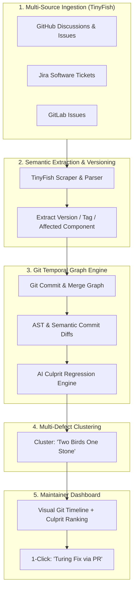

1. improve the cross-issue validation system by texting on eventyay_sandbox, 
    optimize comment contecxt window size based on requirement type, the cuurent system ssems to be listing oyut all open issue in the commnet and then teeling the conflicting ones, which is kinda inappropriate

2. utilize the discussions window of Turing  to implement Jira connection (scope-refinement)

3. remove the reproduction node system for ui bugs (because of irrelevance in bigger systems, can't be trusted)   -- done

4. so can we implement something like sentry, further we make a dashbaord which we can connect without github account, and then add a specific repo and connect other tools like Jira, Gitlab, Github discussions, these all application where developers, users and other will report failures bug etc. , Tinyfish will scrape all reported content, identifying the version of the codebase from which its reported, and make a time series database in route with the commits and merges data, so on the dahbaord mainatiner can see the failure and the segment of the git graph it occured on. Of cousrese I have implemented a bot system whre it checks for other unworked issue to check if the resolution that issue may resolve this issue or not, often called the one rocks two kills idiom, but here the dashbaord scenario is diffenrent, here creating a complete commity base dverisoning history, it tells thta maintainer at what part of the previous commit may have influenced the latets report, it investigates the git graph to find out the last changes commits on teh influenceing issue area, to find out the probabble guiltty of the issue. 


4.a. Yes! That is an exceptional product vision. What you are describing is a **Unified Bug-to-Commit Intelligence Platform** (or **Semantic Git Regression Graph**). 

Sentry only knows about **raw stack traces inside running production code**, and Jira/GitHub only know about **tickets in isolation**. 

Almost nobody bridges **heterogeneous community bug reports (Jira, GitLab, GitHub Discussions)** directly onto the **Git DAG (Commit/Merge Graph)** to autonomously pinpoint the **culprit commit**.

---

### 🧠 The Core Architecture



---

### How Each Layer Solves Your Vision

#### 1. Multi-Platform Ingestion (TinyFish as the Scraper & Normalizer)
- Connect without forcing maintainers to grant full GitHub org admin rights. Maintainers just provide repo URLs or webhook endpoints.
- TinyFish scrapes and normalizes tickets across **Jira, GitLab, and GitHub Discussions** into a single unified JSON schema:
  ```json
  {
    "source": "jira",
    "report_id": "PROJ-1042",
    "reported_version": "v2.4.1",
    "symptoms": ["HTTP 500 on quota creation", "clean_products TypeError"],
    "files_hinted": ["serializers/product.py"],
    "created_at": "2026-10-31T19:14:00Z"
  }
  ```

#### 2. The Git Temporal DAG Engine
Instead of treating commits as a flat list, construct the real **Git Directed Acyclic Graph (DAG)**:
- Maps commits, merges, tags, and releases on an interactive time-series timeline.
- Pins each incoming bug report onto the exact segment of the graph corresponding to the reported release tag or commit SHA.

#### 3. AI Culprit / Regression Detective (Semantic Git Bisect)
When a bug report is pinned at commit `C_reported`:
1. **Backwards Search**: The engine walks backwards through the DAG along the branch history.
2. **Impact Filtering**: It isolates commits modifying the files or symbols mentioned in the report (e.g., `git log -L`, AST function diffs, semantic code embeddings).
3. **LLM Blame Reasoning**: The LLM compares the reported failure symptoms against the diffs of candidate commits and assigns a culprit confidence score:
   > *"Commit `e4f1a09` by `@dev` (merged in PR #118): Refactored `clean_products` to assume dictionary input instead of None. This directly introduced the `TypeError` reported in Discussion #77 and Jira ticket #402."*

#### 4. The "Two Birds, One Stone" Defect Clustering
- If 5 different bug reports (2 from Jira, 2 from Discussions, 1 from GitLab) all point back to the same culprit commit or code segment, the dashboard groups them into a **single defect cluster**.
- A maintainer resolves the root commit once, and Turing closes all 5 tickets across platforms simultaneously.

---

### 🖥️ What the Maintainer Dashboard Looks Like

You already have the foundational Vite + React setup started in `frontend/`! On the UI:
1. **Interactive Git Branch Graph**: A visual graph (similar to GitKraken or GitHub Insights Network) showing commits and merges.
2. **Defect Pins**: Red incident markers plotted right on the commits where users reported issues.
3. **The Culprit Inspector**: Clicking a failure report opens a side panel showing:
   - **Probable Guilty Commit**: SHA, Author, PR link, and Diff snippet.
   - **AI Explanation**: Why this commit likely broke the feature.
   - **Linked Reports**: Related Jira tickets, GitLab issues, and GitHub discussions.
   - **Action Button**: `[⚡ Generate Fix PR with Turing-Agent]`.

---

### 🛠️ Recommended Roadmap to Build This

1. **Step 1: The Culprit Analyzer Module (`tasks/culprit_analyzer.py`)**
   - Create a module that takes `(repo, file_paths, error_summary, base_commit)` and runs `git log` / AST diff comparisons against recent commits to rank the top 3 suspect commits.
2. **Step 2: Time-Series Database / Store**
   - Store incoming reports alongside commit metadata, tags, and timestamps.
3. **Step 3: Multi-Source Webhook & Scraper Ingestion**
   - Extend the backend to accept Jira/GitLab webhook payloads and TinyFish scrapes.
4. **Step 4: Interactive Dashboard**
   - Build out the React frontend in [`frontend/`](file:///c:/Users/yashk/Desktop/TinyFish/Turing-agent/frontend/) with a visual timeline graph component.

Would you like to start by building the **Culprit Analyzer (`tasks/culprit_analyzer.py`)** to test finding the guilty commit for a recent issue like #130 / Discussion #77?

